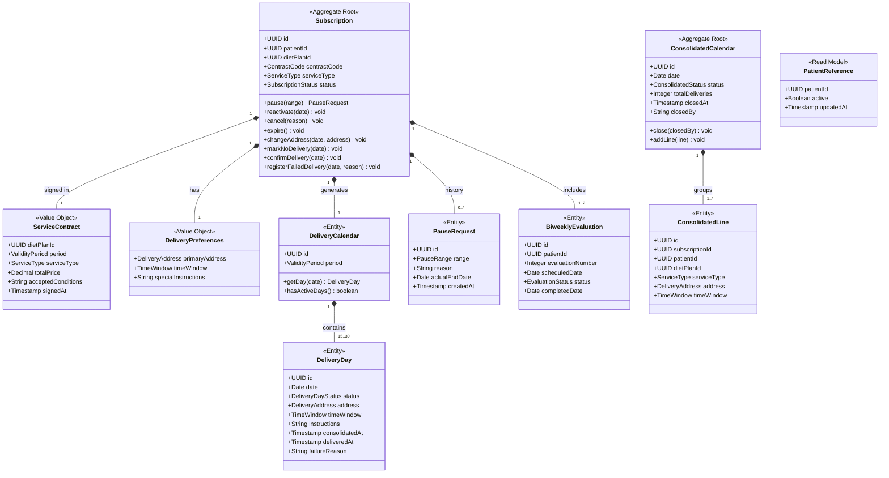
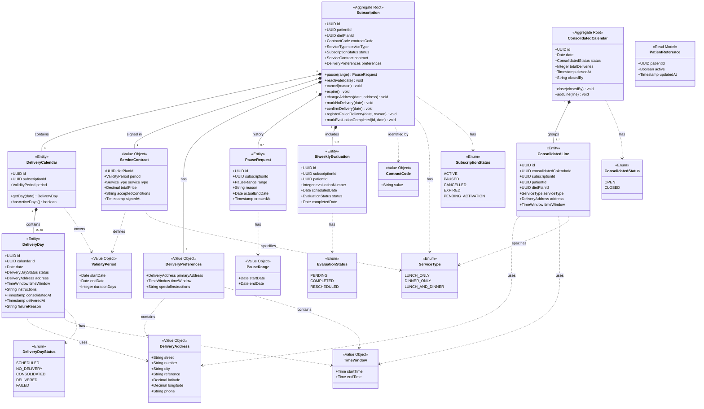

# Diseño Táctico DDD — BC3: Suscripción y Calendario de Catering

## Actividad: Modelo de Dominio — Diagrama de Clases

---

|                        |                                                |
| ---------------------- | ---------------------------------------------- |
| **Proyecto**           | NurTriCenter — Sistema de Nutrición y Catering |
| **Bounded Context**    | BC3 · Suscripción y Calendario de Catering     |
| **Tipo de Subdominio** | Core Domain                                    |
| **Integrante**         | Alvaro _(apellido)_                            |
| **Diplomado**          | Diseño e Implementación de Microservicios      |
| **Fecha**              | Junio 2026                                     |

---

## 1. Contexto del Bounded Context

**BC3** es el contexto responsable de gestionar el ciclo de vida completo del servicio de catering contratado por los pacientes de NurTriCenter. Su dominio cubre:

- La **suscripción** de un paciente a un plan de alimentación (15 o 30 días).
- La **programación del calendario** diario de entregas.
- La **consolidación diaria** que activa la producción en cocina (BC4) y logística (BC5).
- La **generación automática de evaluaciones quincenales** para control clínico (BC1).

> BC3 es autónomo: mantiene una réplica local del estado de los pacientes (via eventos de BC1) y solo referencia los planes dietéticos de BC2 por ID, sin acoplarse a su lógica.

---

## 2. Identificación del Modelo de Dominio

### 2.1 Aggregates y sus Aggregate Roots

Un **Aggregate** es un grupo de objetos de dominio que se tratan como una unidad para garantizar la consistencia. El **Aggregate Root** es el único punto de entrada para modificarlo.

| Aggregate                  | Aggregate Root          | Descripción                                                                                                                                                                       | Justificación                                                                                                                                |
| -------------------------- | ----------------------- | --------------------------------------------------------------------------------------------------------------------------------------------------------------------------------- | -------------------------------------------------------------------------------------------------------------------------------------------- |
| **Suscripción**            | `Suscripcion`           | Contrato activo de catering de un paciente. Gestiona el calendario de entregas, pausas y evaluaciones durante el período contratado (15 o 30 días).                               | Toda operación sobre el calendario, pausas y evaluaciones pasa por ella. Protege las 5 invariantes principales del negocio.                  |
| **Calendario Consolidado** | `CalendarioConsolidado` | Agrupación diaria e inmutable de todas las entregas activas del sistema para una fecha específica. Es el artefacto que activa la producción en cocina (BC4) y la logística (BC5). | Cruza los límites de TODAS las suscripciones activas. Tiene su propio ciclo de vida e inmutabilidad. No puede vivir dentro de `Suscripcion`. |

### 2.2 Entidades

Una **Entidad** tiene **identidad propia** (UUID) y su estado cambia a lo largo del tiempo.

| Entidad                | Aggregate             | Descripción                                                                                                                                                                  | Justificación de identidad                                                      |
| ---------------------- | --------------------- | ---------------------------------------------------------------------------------------------------------------------------------------------------------------------------- | ------------------------------------------------------------------------------- |
| `CalendarioDeEntregas` | Suscripción           | Programación de los días de entrega para el período vigente de una suscripción. Contiene entre 15 y 30 `DíasDeEntrega`.                                                      | Tiene UUID propio. Invariante: no pueden existir 2 días con la misma fecha.     |
| `DiaDeEntrega`         | Suscripción           | Representa una entrega física en una fecha concreta. Tiene dirección, ventana horaria e instrucciones propias que el paciente puede modificar con hasta 48h de anticipación. | Tiene UUID. Su estado cambia: `PROGRAMADO → CONSOLIDADO → ENTREGADO / FALLIDO`. |
| `SolicitudDePausa`     | Suscripción           | Solicitud formal de suspensión temporal del servicio. Registra el rango de fechas pausadas y permite reactivación anticipada.                                                | Tiene UUID. Registra historial auditable de pausas por suscripción.             |
| `EvaluacionQuincenal`  | Suscripción           | Cita de control corporal incluida automáticamente al crear la suscripción. Se genera 1 evaluación para planes de 15 días y 2 para planes de 30 días.                         | Tiene UUID. Su estado cambia: `PENDIENTE → REALIZADA / REPROGRAMADA`.           |
| `LineaConsolidado`     | CalendarioConsolidado | Representa una entrega individual dentro del calendario diario de producción y logística. Contiene todos los datos necesarios para que BC4 y BC5 operen de forma autónoma.   | Tiene UUID. Es la unidad mínima del consolidado diario.                         |

### 2.3 Value Objects

Un **Value Object** no tiene identidad. Es **inmutable** — si un dato cambia, se crea uno nuevo.

| Value Object            | Tipo         | Descripción                                                                                                                                                           | Justificación de inmutabilidad                                                                               |
| ----------------------- | ------------ | --------------------------------------------------------------------------------------------------------------------------------------------------------------------- | ------------------------------------------------------------------------------------------------------------ |
| `ContratoDeServicio`    | VO Compuesto | Registra los términos acordados al momento de la firma: plan contratado, período, tipo de servicio, precio y condiciones aceptadas.                                   | Se firma una vez. Nunca se modifica. Si cambian condiciones → se crea una nueva suscripción.                 |
| `PreferenciasDeEntrega` | VO Compuesto | Configuración por defecto del paciente para sus entregas: dirección principal, ventana horaria e instrucciones especiales. Se usa como base para cada `DíaDeEntrega`. | Al actualizar, se reemplaza el VO completo. No tiene identidad propia.                                       |
| `DireccionDeEntrega`    | VO Compuesto | Dirección física completa de entrega: calle, número, ciudad, referencia y coordenadas GPS (latitud/longitud) para geolocalización logística.                          | Se compara por valor. Cambiarla implica crear un nuevo VO.                                                   |
| `VentanaHoraria`        | VO Compuesto | Franja horaria de entrega definida por `horaInicio` y `horaFin` (ej: 12:00–13:00). Reutilizable en `DíaDeEntrega`, `PreferenciasDeEntrega` y `LineaConsolidado`.      | Franja horaria inmutable. Al cambiar se reemplaza completa.                                                  |
| `PeriodoDeVigencia`     | VO Compuesto | Rango de fechas `[fechaInicio, fechaFin]` del contrato. Calcula automáticamente la fecha de fin a partir de la duración.                                              | **INV-PV-01:** Solo acepta `15` o `30` días. Cualquier otro valor es rechazado en el constructor.            |
| `RangoDePausa`          | VO Compuesto | Período de inicio y fin de una pausa solicitada. Valida que `fechaInicio` sea al menos 48 horas en el futuro.                                                         | Define un rango de fechas específico. Al cambiar cualquier fecha, se crea un nuevo VO.                       |
| `CodigoDeContrato`      | VO Primitivo | Identificador único legible del contrato. Formato: `NTC-YYYY-NNNN`. Generado automáticamente al crear la suscripción.                                                 | Código de solo lectura desde su generación. Inmutable por diseño.                                            |
| `TipoDeServicio`        | Enum         | Modalidad de comidas del contrato.                                                                                                                                    | Valores fijos: `SOLO_ALMUERZO` / `SOLO_CENA` / `ALMUERZO_Y_CENA`. Inmutable una vez activada la suscripción. |
| `EstadoSuscripcion`     | Enum         | Estado actual del ciclo de vida de la suscripción.                                                                                                                    | Valores: `ACTIVA` / `PAUSADA` / `CANCELADA` / `VENCIDA` / `PENDIENTE_ACTIVACION`.                            |
| `EstadoDiaEntrega`      | Enum         | Estado de una entrega individual en el calendario.                                                                                                                    | Valores: `PROGRAMADO` / `NO_ENTREGA` / `CONSOLIDADO` / `ENTREGADO` / `FALLIDO`.                              |
| `EstadoEvaluacion`      | Enum         | Estado de la cita de evaluación quincenal.                                                                                                                            | Valores: `PENDIENTE` / `REALIZADA` / `REPROGRAMADA`.                                                         |
| `EstadoConsolidado`     | Enum         | Estado del ciclo de vida del CalendarioConsolidado.                                                                                                                   | Valores: `ABIERTO` (en construcción) / `CERRADO` (inmutable, publicado a BC4).                               |

### 2.4 Read Model

Un **Read Model** no es parte del dominio de negocio, pero es necesario para la autonomía del microservicio.

| Read Model           | Origen                                                      | Descripción                                                                                                                                                                | Propósito                                                                                              |
| -------------------- | ----------------------------------------------------------- | -------------------------------------------------------------------------------------------------------------------------------------------------------------------------- | ------------------------------------------------------------------------------------------------------ |
| `PacienteReferencia` | Eventos de BC1 (`PacienteRegistrado`, `PacienteInactivado`) | Réplica local del estado de activación de los pacientes. Contiene `pacienteId`, `activo` (boolean) y `actualizadoAt`. Se mantiene actualizada mediante eventos del broker. | Permitir que BC3 valide si un paciente está activo de forma autónoma, sin acoplamiento síncrono a BC1. |

---

## 3. Invariantes del Modelo

Las invariantes son las **reglas de negocio que el Aggregate Root garantiza siempre**, sin excepción.

| ID            | Elemento                 | Regla                                                                                    | Error si se viola             |
| ------------- | ------------------------ | ---------------------------------------------------------------------------------------- | ----------------------------- |
| **INV-01**    | `Suscripcion`            | Un paciente solo puede tener una suscripción `ACTIVA` o `PAUSADA` a la vez               | `SUSCRIPCIÓN_DUPLICADA`       |
| **INV-02**    | `Suscripcion`            | Un `DiaDeEntrega` en estado `CONSOLIDADO` o posterior no puede ser modificado            | `DÍA_BLOQUEADO`               |
| **INV-03**    | `Suscripcion`            | El `TipoDeServicio` es inmutable una vez que la suscripción está `ACTIVA`                | `MODIFICACIÓN_NO_PERMITIDA`   |
| **INV-04**    | `Suscripcion`            | Una suscripción `VENCIDA` o `CANCELADA` no puede ser reactivada                          | `SUSCRIPCIÓN_TERMINADA`       |
| **INV-05**    | `Suscripcion`            | El calendario no puede quedar con todos los días en `NO_ENTREGA`                         | `CALENDARIO_SIN_DÍAS_ACTIVOS` |
| **INV-06**    | `CalendarioDeEntregas`   | No pueden existir dos `DiaDeEntrega` con la misma fecha en el mismo calendario           | `FECHA_DUPLICADA`             |
| **INV-07**    | `CalendarioConsolidado`  | Una vez `CERRADO`, ninguna `LineaConsolidado` puede ser modificada, agregada o eliminada | `CONSOLIDADO_INMUTABLE`       |
| **INV-PV-01** | `PeriodoDeVigencia` (VO) | `durationDays` solo puede ser `15` o `30` (establecido en el Caso de Estudio)            | `DURACIÓN_NO_VÁLIDA`          |

---

## 4. Diagrama de Clases — Estructura de Aggregates

> Muestra las relaciones de **composición** entre Aggregates, Entities y Value Objects compuestos. Los tipos de los atributos dentro de cada clase comunican el uso de VOs, eliminando el ruido de flechas redundantes.

**Leyenda:**

- 🔵 Azul oscuro = `<<Aggregate Root>>`
- 🟦 Azul medio = `<<Entity>>`
- 🟢 Verde = `<<Value Object>>`
- 🟠 Naranja = `<<Read Model>>`
- `*--` = Composición (el hijo no existe sin el padre)

---

## 5. Diagrama de Clases — Catálogo de Value Objects

> Muestra todos los Value Objects con sus campos. Los Enums representan los posibles estados del sistema.

```mermaid
classDiagram
    class DeliveryAddress {
        <<Value Object>>
        +String street
        +String number
        +String city
        +String reference
        +Decimal latitude
        +Decimal longitude
        +String phone
    }

    class TimeWindow {
        <<Value Object>>
        +Time startTime
        +Time endTime
    }

    class ValidityPeriod {
        <<Value Object>>
        +Date startDate
        +Date endDate
        +Integer durationDays
    }

    class ContractCode {
        <<Value Object>>
        +String value
    }

    class PauseRange {
        <<Value Object>>
        +Date startDate
        +Date endDate
    }

    class ServiceType {
        <<Enum>>
        LUNCH_ONLY
        DINNER_ONLY
        LUNCH_AND_DINNER
    }

    class SubscriptionStatus {
        <<Enum>>
        ACTIVE
        PAUSED
        CANCELLED
        EXPIRED
        PENDING_ACTIVATION
    }

    class DeliveryDayStatus {
        <<Enum>>
        SCHEDULED
        NO_DELIVERY
        CONSOLIDATED
        DELIVERED
        FAILED
    }

    class EvaluationStatus {
        <<Enum>>
        PENDING
        COMPLETED
        RESCHEDULED
    }

    class ConsolidatedStatus {
        <<Enum>>
        OPEN
        CLOSED
    }

```

---

## 6. Diagrama de Clases — Modelo Completo (referencia técnica)

> Versión extendida con todas las relaciones de uso hacia Value Objects para trazabilidad completa.

---

## 7. Decisiones de Diseño Clave

Estas correcciones se realizaron durante el análisis táctico con respecto al modelo estratégico inicial:

| Decisión                                                              | Justificación DDD                                                                                            |
| --------------------------------------------------------------------- | ------------------------------------------------------------------------------------------------------------ |
| `ContratoDeServicio` → **Value Object** (antes era Entidad)           | Es inmutable. No tiene comportamientos propios. Si cambian condiciones, se crea una nueva suscripción.       |
| `LineaConsolidado` → **Entidad explícita** (antes solo existía en BD) | Tiene identidad propia y forma parte del Aggregate `CalendarioConsolidado`.                                  |
| `VentanaHoraria` → **VO independiente** (antes embebida en otros VOs) | Reutilizada en `DeliveryDay`, `DeliveryPreferences` y `ConsolidatedLine`. Extraerla evita duplicación.       |
| `PacienteReferencia` → **Read Model** (no parte del dominio)          | Proyección local de eventos de BC1. Garantiza autonomía del microservicio sin acoplamiento síncrono.         |
| `EstadoConsolidado` → **VO nuevo**                                    | El ciclo de vida `ABIERTO → CERRADO` del `CalendarioConsolidado` necesita su propio tipo.                    |
| `PeriodoDeVigencia` con **INV-PV-01**                                 | El Caso de Estudio solo define planes de 15 o 30 días. El VO rechaza cualquier otro valor en su constructor. |

---

_Actividad: Diseño Táctico DDD — Modelo de Dominio_  
_Responsable del BC3: Alvaro (apellido)_  
_NurTriCenter · Trabajo Final · Diplomado en Microservicios · 2026_
