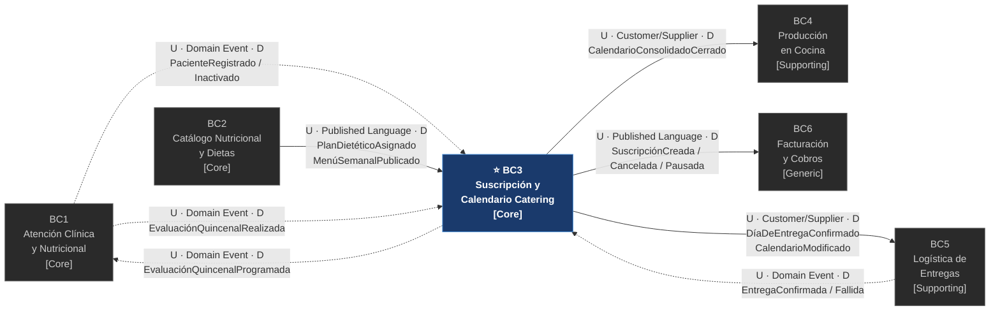
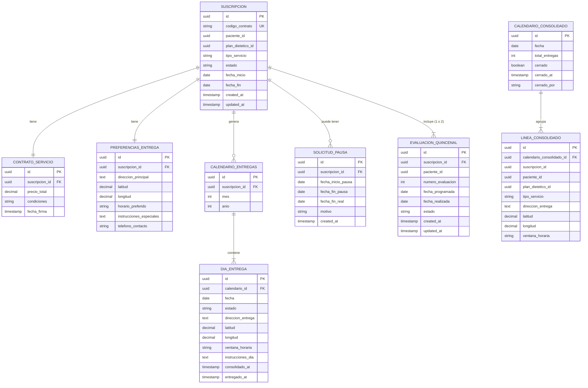
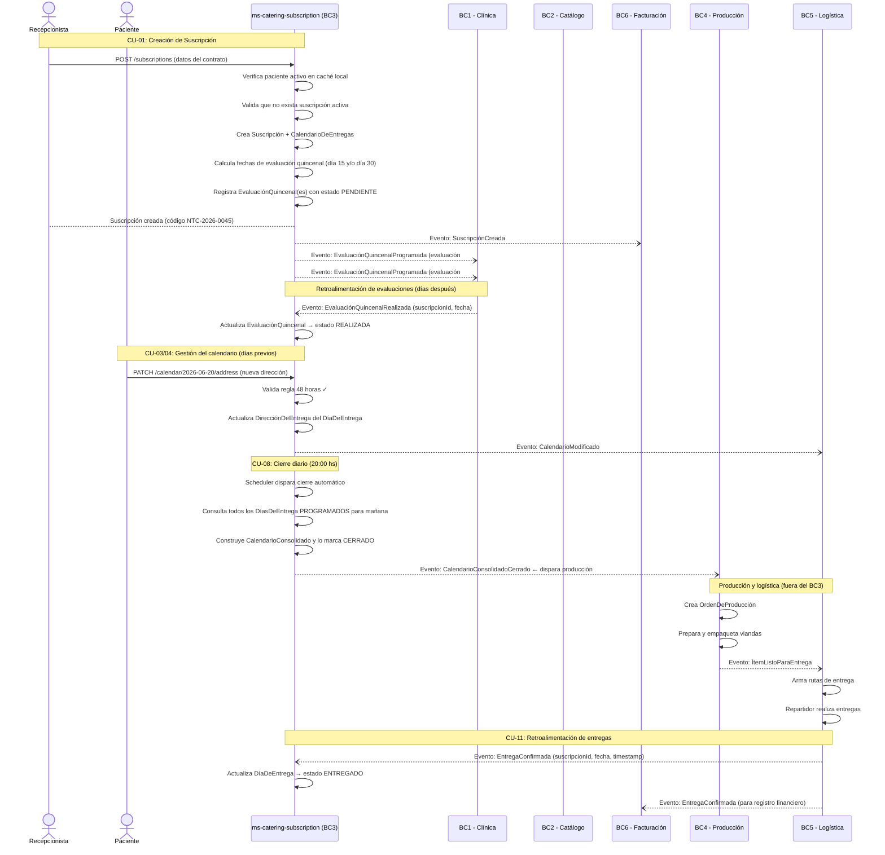

# BC3 · Suscripción y Calendario de Catering
## Nur-tricenter — Diseño Estratégico DDD · Análisis Profundo

---

**Integrante Responsable:** Alvaro _(apellido)_  
**Contexto Asignado:** BC3 · Suscripción y Calendario de Catering  
**Tipo de Subdominio:** Core Domain  
**Fecha:** Junio 2026  

---

## Tabla de Contenidos

1. [Descripción del Contexto](#1-descripción-del-contexto)
2. [Lenguaje Ubicuo](#2-lenguaje-ubicuo)
   - [Actores](#21-actores)
   - [Conceptos del Dominio](#22-conceptos-del-dominio-entidades-y-value-objects)
   - [Eventos de Dominio](#23-eventos-de-dominio)
   - [Reglas de Negocio](#24-reglas-de-negocio-clave)
3. [Posición en el Context Map](#3-posición-en-el-context-map)
4. [Microservicio: ms-catering-subscription](#4-microservicio-ms-catering-subscription)
   - [Descripción General](#41-descripción-general)
   - [Responsabilidades](#42-responsabilidades)
   - [Lo que NO es responsabilidad de este microservicio](#43-lo-que-no-es-responsabilidad-de-este-microservicio)
   - [API y Contratos Publicados](#44-api-y-contratos-publicados)
5. [Casos de Uso Detallados](#5-casos-de-uso-detallados)
   - [CU-01: Crear Suscripción de Catering](#cu-01-crear-suscripción-de-catering)
   - [CU-02: Configurar Calendario de Entregas](#cu-02-configurar-calendario-de-entregas)
   - [CU-03: Cambiar Dirección de Entrega de un Día](#cu-03-cambiar-dirección-de-entrega-de-un-día)
   - [CU-04: Marcar Día como No Entrega](#cu-04-marcar-día-como-no-entrega)
   - [CU-05: Solicitar Pausa de Suscripción](#cu-05-solicitar-pausa-de-suscripción)
   - [CU-06: Cancelar Suscripción](#cu-06-cancelar-suscripción)
   - [CU-07: Reactivar Suscripción Pausada](#cu-07-reactivar-suscripción-pausada)
   - [CU-08: Cierre Diario del Calendario Consolidado](#cu-08-cierre-diario-del-calendario-consolidado)
   - [CU-09: Consultar Estado de Suscripción](#cu-09-consultar-estado-de-suscripción)
   - [CU-10: Consultar y Gestionar Calendario desde App del Paciente](#cu-10-consultar-y-gestionar-calendario-desde-app-del-paciente)
   - [CU-11: Registrar Resultado de Entrega en el Calendario](#cu-11-registrar-resultado-de-entrega-en-el-calendario)
   - [CU-12: Renovar Suscripción al Vencimiento](#cu-12-renovar-suscripción-al-vencimiento)
6. [Modelo de Datos del Dominio](#6-modelo-de-datos-del-dominio)
7. [Flujo Principal End-to-End del BC3](#7-flujo-principal-end-to-end-del-bc3)

---

## 1. Descripción del Contexto

> **Visión del contexto:** BC3 es el **orquestador del ciclo de vida del servicio de catering**. Gestiona el contrato entre el paciente y NurTriCenter, define cuándo y dónde se entregan las viandas, y produce diariamente el **Calendario Consolidado** — el artefacto más crítico del sistema, que dispara toda la cadena de producción y logística.

Este contexto es **Core Domain** porque contiene la lógica de negocio más diferenciadora de NurTriCenter: la gestión personalizada del calendario de entregas por paciente. Ninguna solución estándar del mercado maneja la combinación de:
- Planes de alimentación individualizados con días variables
- Reglas de anticipación para cambios (2 días hábiles)
- Consolidación diaria automática que dispara la cocina
- Pausas parciales y cambios de dirección por día

**Relación con el negocio:** Sin este contexto funcionando correctamente, la cocina (BC4) no puede producir, los repartidores (BC5) no pueden entregar, y el negocio no puede facturar (BC6). Es el corazón operativo del servicio de catering.

---

## 2. Lenguaje Ubicuo

### 2.1 Actores

| Actor | Rol en este Contexto | Descripción |
|---|---|---|
| **Paciente** | Principal | Contrata el servicio, configura su calendario y solicita cambios a través de la app o en recepción |
| **Recepcionista / Asesor Comercial** | Administrativo | Crea y gestiona los contratos de suscripción en nombre del paciente. Aprueba solicitudes especiales |
| **Coordinador de Operaciones** | Supervisión | Supervisa el cierre diario del calendario consolidado y gestiona excepciones de último momento |
| **Sistema (Proceso Automático)** | Automatización | Ejecuta el cierre del `CalendarioConsolidado` al final de cada día hábil sin intervención humana |
| **BC4 – Producción** | Consumidor externo | Recibe el `CalendarioConsolidadoCerrado` para generar la Orden de Producción |
| **BC5 – Logística** | Consumidor externo | Recibe los `DíasDeEntregaConfirmados` para planificar rutas |
| **BC6 – Facturación** | Consumidor externo | Recibe eventos del ciclo de vida de la suscripción para generar facturas |
| **BC1 – Clínica** | Proveedor externo | Proporciona el `PacienteId` para verificar que el paciente existe y está activo |

---

### 2.2 Conceptos del Dominio (Entidades y Value Objects)

#### Entidades y Aggregates

| Término | Tipo | Definición precisa en este contexto |
|---|---|---|
| **Suscripción** | Entidad **(Aggregate Root)** | Contrato activo de catering de un paciente. Define el período de vigencia, el plan de comidas contratado, los días de entrega y el estado actual. Es la raíz del aggregate: toda operación sobre el calendario pasa por ella. |
| **CalendarioDeEntregas** | Entidad (dentro de Suscripción) | Programación mensual de los días de entrega para una suscripción activa. Contiene la lista completa de `DíasDeEntrega` del mes y su estado. Invariante: no pueden existir dos `DíasDeEntrega` con la misma fecha en el mismo calendario. |
| **DíaDeEntrega** | Entidad (dentro de CalendarioDeEntregas) | Representa una entrega específica en una fecha concreta. Tiene su propia `DirecciónDeEntrega`, `VentanaHoraria`, estado y puede ser marcado como No Entrega. Es la unidad mínima de planificación. |
| **SolicitudDePausa** | Entidad (dentro de Suscripción) | Solicitud formal del paciente para suspender temporalmente sus entregas durante un rango de fechas. Requiere aprobación y cumplir la regla de anticipación. |
| **EvaluaciónQuincenal** | Entidad (dentro de Suscripción) | Cita de control corporal incluida automáticamente en el servicio de catering. Se genera al momento de crear la suscripción: 1 evaluación si el plan es de 15 días, 2 evaluaciones si es de 30 días. BC3 solo registra la fecha programada y notifica a BC1 para que gestione la cita clínica. |
| **CalendarioConsolidado** | Entidad **(Aggregate Root independiente)** | Agregación diaria de **todos** los `DíasDeEntrega` activos de **todas** las suscripciones para una fecha específica. Es inmutable una vez cerrado (estado `CERRADO`). Es el artefacto que activa BC4. |
| **LineaConsolidado** | Entidad (dentro de CalendarioConsolidado) | Representa una entrega individual dentro del calendario diario de producción y logística. Contiene el `pacienteId`, `planDietéticoId`, `tipoServicio`, `direcciónDeEntrega` y `ventanaHoraria` para ese día. |

#### Value Objects

| Término | Tipo | Definición precisa en este contexto |
|---|---|---|
| **TipoDeServicio** | Value Object | Modalidad de comidas contratadas. Valores posibles: `SOLO_ALMUERZO`, `SOLO_CENA`, `ALMUERZO_Y_CENA`. Inmutable una vez firmado el contrato. |
| **PreferenciasDeEntrega** | Value Object | Configuración por defecto del paciente: `DireccionPrincipal` (VO), `VentanaHoraria` (VO) e instrucciones especiales. Sirve como valor base para cada `DíaDeEntrega`. |
| **DirecciónDeEntrega** | Value Object | Dirección física completa para una entrega específica: calle, número, ciudad, referencia, coordenadas GPS (latitud/longitud para geolocalización), y teléfono de contacto. |
| **VentanaHoraria** | Value Object | Franja horaria de entrega (ej: `12:00–13:00`). Compuesta por `horaInicio` y `horaFin`. Aparece en `PreferenciasDeEntrega`, `DíaDeEntrega` y `LineaConsolidado`. |
| **PeriodoDeVigencia** | Value Object | Rango de fechas `[fechaInicio, fechaFin]` del contrato. **INV-PV-01:** `duracionDias` solo puede ser `15` o `30` (valores establecidos en el Caso de Estudio). Cualquier otro valor lanza `DuracionNoVálidaException`. No existe renovación automática. |
| **ContratoDeServicio** | Value Object _(corregido desde Entidad)_ | Términos inmutables del acuerdo firmado al momento de la suscripción: `planDietéticoId`, `periodo`, `tipoServicio`, `precioTotal`, `condicionesAceptadas` y `fechaFirma`. Al ser inmutable y sin identidad propia, es un Value Object, no una Entidad. |
| **EstadoSuscripción** | Value Object | Estado actual de la suscripción. Valores: `ACTIVA`, `PAUSADA`, `CANCELADA`, `VENCIDA`, `PENDIENTE_ACTIVACIÓN`. |
| **EstadoDíaEntrega** | Value Object | Estado de un día de entrega individual. Valores: `PROGRAMADO`, `NO_ENTREGA` (marcado por paciente), `CONSOLIDADO` (incluido en el calendario del día), `ENTREGADO`, `FALLIDO`. |
| **EstadoEvaluación** | Value Object | Estado de una evaluación quincenal programada. Valores: `PENDIENTE` (fecha asignada, esperando la cita), `REALIZADA` (BC1 confirmó la cita), `REPROGRAMADA` (fecha modificada a pedido del paciente). |
| **EstadoConsolidado** | Value Object | Estado del ciclo de vida del `CalendarioConsolidado`. Valores: `ABIERTO` (en construcción durante el proceso de cierre), `CERRADO` (inmutable, ya publicado a BC4). |
| **RangoDePausa** | Value Object | Período de inicio y fin de una pausa solicitada. Debe cumplir la regla de 48 horas de anticipación desde `fechaInicio`. |
| **CódigoDeContrato** | Value Object | Identificador único legible del contrato (ej: `NTC-2026-0045`). Formato: `NTC-YYYY-NNNN`. Generado automáticamente al crear la suscripción. |

---

### 2.3 Eventos de Dominio

#### Eventos que publica este contexto

| Evento | Cuándo se emite | Quién lo consume | Datos que incluye |
|---|---|---|---|
| `SuscripciónCreada` | Al formalizar un nuevo contrato de catering | BC6 (para facturar el contrato inicial) | `suscripcionId`, `pacienteId`, `planDietéticoId`, `periodoDeVigencia`, `tipoServicio`, `precioTotal` |
| `SuscripciónCancelada` | Al cancelar una suscripción activa | BC6 (para aplicar cargos o devoluciones) | `suscripcionId`, `pacienteId`, `fechaCancelación`, `motivoCancelación`, `diasRestantes` |
| `SuscripciónPausada` | Al aprobar una solicitud de pausa | BC6 (para ajustar facturación del período) | `suscripcionId`, `pacienteId`, `rangoDePausa`, `diasAfectados` |
| `SuscripciónReactivada` | Al reactivar una suscripción pausada antes de tiempo | BC6 (para ajustar facturación) | `suscripcionId`, `pacienteId`, `fechaReactivación` |
| `CalendarioConsolidadoCerrado` | Al cierre del día hábil (proceso automático) | **BC4** (dispara creación de OrdenDeProducción) | `fecha`, `totalEntregas`, `listadoDeEntregas[]` (con `pacienteId`, `planDietéticoId`, `tipoServicio`, `direcciónDeEntrega`) |
| `DíaDeEntregaConfirmado` | Al confirmar los días del calendario mensual | BC5 (para planificar rutas con anticipación) | `suscripcionId`, `pacienteId`, `fecha`, `direcciónDeEntrega`, `tipoServicio` |
| `CalendarioModificado` | Cuando el paciente cambia dirección o marca no entrega | BC5 (para actualizar planificación de rutas) | `suscripcionId`, `pacienteId`, `fecha`, `tipoModificación`, `nuevoValor` |
| `SuscripciónVencida` | Cuando la fecha fin del período es alcanzada sin renovación | BC6 (para cierre de cuenta) | `suscripcionId`, `pacienteId`, `fechaVencimiento` |
| `EvaluaciónQuincenalProgramada` | Al crear una suscripción de catering (automático) | **BC1** (para reservar la cita clínica en la agenda del nutricionista) | `suscripcionId`, `pacienteId`, `numeroEvaluacion` (1 o 2), `fechaProgramada`, `duracionPlan` |

#### Eventos que consume este contexto

| Evento Recibido | Contexto Origen | Acción que realiza BC3 |
|---|---|---|
| `PacienteRegistrado` | BC1 | Crea un registro local (caché) del paciente para permitirle suscribirse de forma autónoma |
| `PacienteInactivado` | BC1 | Actualiza el registro local para bloquear la creación de nuevas suscripciones |
| `PlanDietéticoAsignado` | BC2 | Vincula el plan al contrato de suscripción activo |
| `EntregaConfirmada` | BC5 | Marca el `DíaDeEntrega` como `ENTREGADO` en el calendario |
| `EntregaFallida` | BC5 | Marca el `DíaDeEntrega` como `FALLIDO` y gestiona reprogramación |
| `EvaluaciónQuincenalRealizada` | BC1 | Actualiza el estado de la `EvaluaciónQuincenal` a `REALIZADA` en el registro de BC3 |

---

### 2.4 Reglas de Negocio Clave

| # | Regla | Consecuencia si se viola |
|---|---|---|
| RN-01 | Un paciente **solo puede tener una suscripción en estado `ACTIVA` o `PAUSADA`** a la vez | El sistema rechaza la solicitud con error `SUSCRIPCIÓN_DUPLICADA` |
| RN-02 | Cualquier modificación al calendario (cambio de dirección, marcar no entrega) debe realizarse con **mínimo 48 horas de anticipación** respecto al día afectado | El sistema rechaza el cambio con error `PLAZO_MODIFICACIÓN_VENCIDO` |
| RN-03 | El `CalendarioConsolidado` se cierra **una vez al día** (al finalizar el día hábil) y es **inmutable** una vez cerrado | No se permiten modificaciones a días cuyo calendario ya fue cerrado |
| RN-04 | Una `SolicitudDePausa` debe indicar un rango de fechas futuras con al menos **48 horas de anticipación** desde la fecha de inicio de la pausa | El sistema rechaza la solicitud con error `PAUSA_SIN_ANTICIPACIÓN` |
| RN-05 | Los `DíasDeEntrega` deben usar como dirección base las `PreferenciasDeEntrega` del paciente, pero pueden sobreescribirse individualmente | Cada día puede tener una dirección distinta |
| RN-06 | Solo los pacientes con estado "activo" en la **réplica local** pueden crear nuevas suscripciones | El sistema consulta su propia base de datos (actualizada por eventos de BC1) antes de crear el contrato |
| RN-07 | El plan de alimentación (`PlanDietéticoId`) referenciado en el contrato es **solo un identificador** — BC3 no almacena ni conoce el contenido del plan | La lógica del plan pertenece a BC2; BC3 solo lo referencia como ID |
| RN-08 | Una `Suscripción` vencida no puede reactuivarse; debe crearse una **nueva suscripción** | El sistema rechaza con error `SUSCRIPCIÓN_VENCIDA` |
| RN-09 | El `TipoDeServicio` no puede modificarse una vez que la suscripción está **ACTIVA** | Requiere cancelar y crear una nueva suscripción |
| RN-10 | Al menos un día de la semana debe estar habilitado para entrega. El sistema no permite marcar **todos** los días como `NO_ENTREGA` simultáneamente | El sistema rechaza con error `CALENDARIO_SIN_DÍAS_ACTIVOS` |
| RN-11 | Al crear una suscripción, el sistema genera **automáticamente** las evaluaciones quincenales: **1 evaluación** (día 15) para planes de 15 días, **2 evaluaciones** (día 15 y día 30) para planes de 30 días | Si la lógica de generación falla, la suscripción no se crea (operación atómica) |
| RN-12 | Las fechas de evaluación quincenal se calculan como `fechaInicio + 15 días` y `fechaInicio + 30 días`. Si la fecha calculada cae en fin de semana o feriado, se programa para el siguiente día hábil | El sistema ajusta la fecha automáticamente al crear la suscripción |

---

## 3. Posición en el Context Map

BC3 es el **contexto más conectado** del sistema. Actúa simultáneamente como consumidor (downstream) de BC1 y BC2, como proveedor (upstream) de BC4, BC5 y BC6, y tiene una relación de retroalimentación con BC5.

| Relación | Patrón | Descripción |
|---|---|---|
| BC1 → **BC3** | Domain Event | BC3 mantiene una réplica local (Event-Carried State Transfer) del estado del paciente para validaciones sin acoplamiento síncrono. |
| BC2 → **BC3** | Published Language | BC3 consume el `PlanDietéticoId` y el menú publicado por BC2. |
| **BC3** → BC4 | Customer/Supplier (Event) | BC3 es el proveedor que alimenta toda la producción con el `CalendarioConsolidado`. |
| **BC3** → BC5 | Customer/Supplier (Event) | BC3 informa a logística qué entregar, dónde y cuándo. |
| **BC3** → BC6 | Published Language | BC3 publica el ciclo de vida del contrato para facturación automática. |
| **BC3** → BC1 | Domain Event | BC3 notifica a la clínica las fechas de evaluación quincenal programadas para que BC1 reserve la cita en la agenda del nutricionista. |
| BC5 → **BC3** | Domain Event (feedback) | BC5 retroalimenta el estado real de cada entrega en el calendario. |
| BC1 → **BC3** | Domain Event (feedback) | BC1 confirma cuándo se realizó la evaluación quincenal para que BC3 actualice su registro. |

---

## 4. Microservicio: ms-catering-subscription

### 4.1 Descripción General

| Atributo | Valor |
|---|---|
| **Nombre del microservicio** | `ms-catering-subscription` |
| **Nombre del integrante responsable** | Alvaro _(apellido)_ |
| **Bounded Context** | BC3 · Suscripción y Calendario de Catering |
| **Tipo de subdominio** | Core Domain |
| **Patrón de arquitectura** | Hexagonal (Ports & Adapters) con CQRS ligero |
| **Comunicación saliente** | Eventos asíncronos vía message broker (RabbitMQ / Kafka) |
| **Comunicación entrante** | REST API (comandos) + consumo de eventos (suscripciones) |
| **Base de datos** | Propia e independiente (PostgreSQL) — sin compartir esquema con otros microservicios |

---

### 4.2 Responsabilidades

Este microservicio es el **único dueño** de los siguientes datos y procesos:

1. **Gestión del ciclo de vida de la Suscripción:** crear, activar, pausar, reactivar, cancelar y vencer contratos de catering.
2. **Gestión del Calendario de Entregas:** configurar los días de entrega de cada suscripción, incluyendo la dirección específica por día.
3. **Gestión de excepciones del calendario:** procesar solicitudes de cambio de dirección y marcado de días como no entrega, respetando la regla de las 48 horas.
4. **Proceso de Cierre Diario:** consolidar todos los días de entrega del día siguiente en el `CalendarioConsolidado` y publicarlo como evento.
5. **Notificación a contextos dependientes:** publicar todos los eventos del dominio que disparan los procesos de BC4, BC5 y BC6.
6. **Consultas del estado del calendario:** exponer el estado actual del calendario del paciente para la app mobile y el panel administrativo.

---

### 4.3 Lo que NO es responsabilidad de este microservicio

> Estas fronteras son críticas para mantener la cohesión del diseño:

- ❌ **No gestiona el contenido del plan alimenticio** (eso es BC2). Solo almacena el `planDietéticoId` como referencia opaca.
- ❌ **No conoce ni calcula valores nutricionales** de las viandas.
- ❌ **No gestiona la producción** de las viandas (eso es BC4).
- ❌ **No planifica rutas** de entrega (eso es BC5).
- ❌ **No emite facturas ni registra cobros** (eso es BC6).
- ❌ **No almacena datos personales del paciente** (nombre, historial clínico). Solo usa `pacienteId` como referencia.
- ❌ **No valida si el plan es adecuado** para el paciente desde el punto de vista nutricional (eso es BC1 y BC2).

---

### 4.4 API y Contratos Publicados

#### Endpoints REST (Comandos y Consultas)

| Método | Endpoint | Descripción |
|---|---|---|
| `POST` | `/api/v1/subscriptions` | Crear nueva suscripción |
| `GET` | `/api/v1/subscriptions/{id}` | Consultar estado de una suscripción |
| `GET` | `/api/v1/subscriptions/patient/{patientId}` | Obtener suscripción activa de un paciente |
| `POST` | `/api/v1/subscriptions/{id}/pause` | Solicitar pausa de la suscripción |
| `POST` | `/api/v1/subscriptions/{id}/reactivate` | Reactivar una suscripción pausada |
| `DELETE` | `/api/v1/subscriptions/{id}` | Cancelar una suscripción |
| `GET` | `/api/v1/subscriptions/{id}/calendar` | Obtener el calendario de entregas del mes |
| `PATCH` | `/api/v1/subscriptions/{id}/calendar/{date}/address` | Cambiar dirección de un día específico |
| `PATCH` | `/api/v1/subscriptions/{id}/calendar/{date}/skip` | Marcar día como no entrega |
| `POST` | `/api/v1/consolidated-calendar/close` | Disparar cierre manual del calendario consolidado (uso administrativo) |
| `GET` | `/api/v1/consolidated-calendar/{date}` | Consultar el calendario consolidado de una fecha |

#### Eventos publicados al Message Broker

| Tópico / Exchange | Evento | Consumidores |
|---|---|---|
| `subscription.created` | `SuscripciónCreada` | BC6 |
| `subscription.cancelled` | `SuscripciónCancelada` | BC6 |
| `subscription.paused` | `SuscripciónPausada` | BC6 |
| `subscription.reactivated` | `SuscripciónReactivada` | BC6 |
| `subscription.expired` | `SuscripciónVencida` | BC6 |
| `calendar.consolidated.closed` | `CalendarioConsolidadoCerrado` | BC4 |
| `calendar.day.confirmed` | `DíaDeEntregaConfirmado` | BC5 |
| `calendar.modified` | `CalendarioModificado` | BC5 |
| `evaluation.scheduled` | `EvaluaciónQuincenalProgramada` | **BC1** |

---

## 5. Historias de Usuario

---

### HU-01: Crear Suscripción de Catering

**Como** Recepcionista o Asesor Comercial  
**Quiero** crear un contrato de suscripción de catering para un paciente  
**Para** definir su plan alimenticio, días de entrega y habilitar su calendario mensual.

**Criterios de Aceptación:**
1. El sistema debe verificar en la caché local que el paciente existe y está activo.
2. El sistema debe validar que el paciente no tenga ya una suscripción `ACTIVA` o `PAUSADA` (Error: `SUSCRIPCION_DUPLICADA`).
3. La fecha de inicio debe ser futura (mínimo 1 día hábil desde hoy).
4. El sistema generará el `CalendarioDeEntregas` automáticamente usando las preferencias por defecto del paciente.
5. El sistema generará automáticamente las **evaluaciones quincenales**: 1 evaluación (día 15) para planes de 15 días; 2 evaluaciones (día 15 y día 30) para planes de 30 días. Si la fecha cae en fin de semana o feriado, se mueve al siguiente día hábil.
6. Se emitirá el evento `EvaluaciónQuincenalProgramada` por cada evaluación generada, para que BC1 reserve la cita clínica.
7. Se emitirá el evento `SuscripciónCreada` para notificar a Facturación (BC6).
8. Todos los pasos 4, 5, 6 y 7 son **atómicos**: si cualquiera falla, la suscripción no se crea.

---

### HU-02: Configurar Calendario de Entregas

**Como** Recepcionista o Paciente  
**Quiero** configurar las direcciones y horarios de entrega para múltiples días  
**Para** asegurar que la vianda llegue a mi domicilio u oficina según mi rutina semanal.

**Criterios de Aceptación:**
1. El sistema debe mostrar el calendario indicando qué días son modificables.
2. Solo se pueden editar días que estén a más de 48 horas de distancia y que no hayan sido consolidados.
3. El sistema debe emitir un evento `DíaDeEntregaConfirmado` por cada día actualizado.

---

### HU-03: Cambiar Dirección de Entrega de un Día Específico

**Como** Paciente (desde la App)  
**Quiero** cambiar mi dirección de entrega para un día específico  
**Para** recibir mi vianda en una ubicación distinta (ej. fin de semana o feriado).

**Criterios de Aceptación:**
1. El paciente puede seleccionar una dirección guardada o ingresar una nueva con geolocalización.
2. El sistema debe validar estrictamente la regla de las 48 horas de anticipación.
3. Si la regla se cumple, la dirección se actualiza y se emite el evento `CalendarioModificado`.

---

### HU-04: Marcar Día como No Entrega (Ausencia)

**Como** Paciente (desde la App)  
**Quiero** marcar un día específico para no recibir mi vianda  
**Para** evitar que la comida se pierda si tengo un viaje o compromiso.

**Criterios de Aceptación:**
1. El sistema advertirá al paciente que los días marcados como "No Entrega" no generan descuentos ni reembolsos.
2. Debe aplicarse la regla de 48 horas de anticipación.
3. El estado del día cambiará a `NO_ENTREGA` y no será incluido en la orden de producción de esa fecha.

---

### HU-05: Solicitar Pausa de Suscripción

**Como** Paciente  
**Quiero** pausar mi suscripción por un rango de fechas determinado  
**Para** suspender mis entregas temporalmente sin perder el crédito de los días contratados.

**Criterios de Aceptación:**
1. La fecha de inicio de la pausa debe tener al menos 48 horas de anticipación.
2. La fecha de fin debe estar dentro del periodo de vigencia del contrato.
3. La suscripción cambiará a estado `PAUSADA` y los días afectados se marcarán como `NO_ENTREGA`.
4. El sistema publicará el evento `SuscripciónPausada`.

---

### HU-06: Cancelar Suscripción

**Como** Recepcionista  
**Quiero** cancelar definitivamente una suscripción activa  
**Para** detener todas las entregas futuras del paciente.

**Criterios de Aceptación:**
1. Todos los días futuros no consolidados se marcan como `NO_ENTREGA`.
2. La suscripción pasa a estado `CANCELADA`.
3. Se publica el evento `SuscripciónCancelada` informando los días restantes, permitiendo que BC6 evalúe si aplica una nota de crédito.

---

### HU-07: Reactivar Suscripción Pausada

**Como** Paciente o Recepcionista  
**Quiero** reactivar mi suscripción antes de que finalice la pausa  
**Para** volver a recibir mis viandas a partir de una fecha específica.

**Criterios de Aceptación:**
1. La fecha de reactivación propuesta debe respetar la regla de 48 horas.
2. Los días desde la reactivación en adelante vuelven a estado `PROGRAMADO`.
3. La suscripción regresa a estado `ACTIVA`.
4. Se publica el evento `SuscripciónReactivada`.

---

### HU-08: Cierre Diario del Calendario Consolidado

**Como** Sistema (Proceso Automático) / Coordinador de Operaciones  
**Quiero** consolidar todas las entregas del día siguiente a una hora de corte (ej. 20:00)  
**Para** generar el listado definitivo de órdenes que se enviará a Cocina.

**Criterios de Aceptación:**
1. El scheduler debe activarse automáticamente a la hora configurada.
2. Debe agrupar todos los DíasDeEntrega en estado `PROGRAMADO` para la fecha de mañana.
3. El `CalendarioConsolidado` resultante será inmutable.
4. Los días de los pacientes cambian a estado `CONSOLIDADO`.
5. Se emite el evento crítico `CalendarioConsolidadoCerrado` hacia BC4.

---

### HU-09: Consultar Estado de Suscripción

**Como** Recepcionista / Atención al Cliente  
**Quiero** visualizar el estado completo de una suscripción y su calendario  
**Para** responder dudas del paciente o realizar auditorías.

**Criterios de Aceptación:**
1. El sistema debe mostrar el estado actual, el tipo de servicio y el plan asignado.
2. Debe mostrar un resumen del mes: días consolidados, días entregados, fallidos y omitidos.
3. Se debe visualizar el historial de modificaciones del calendario.

---

### HU-10: Consultar y Gestionar Calendario desde App

**Como** Paciente  
**Quiero** ver mi calendario mensual de entregas con un código de colores  
**Para** identificar fácilmente qué días recibiré viandas y qué días puedo aún modificar.

**Criterios de Aceptación:**
1. Mostrar días `PROGRAMADOS` modificables (ej. azul) y bloqueados (< 48h, ej. gris).
2. Mostrar claramente días `CONSOLIDADOS`, `ENTREGADOS`, `FALLIDOS` y `NO_ENTREGA`.
3. Al tocar un día modificable, el usuario puede acceder directamente a las funciones de cambio de dirección o no entrega.

---

### HU-11: Registrar Resultado de Entrega

**Como** Sistema  
**Quiero** recibir y procesar los eventos de confirmación o fallo desde Logística (BC5)  
**Para** mantener el calendario del paciente actualizado con la realidad física de la entrega.

**Criterios de Aceptación:**
1. Al recibir `EntregaConfirmada`, el DíaDeEntrega pasa a `ENTREGADO`.
2. Al recibir `EntregaFallida`, el DíaDeEntrega pasa a `FALLIDO` y se guarda el motivo.
3. El paciente debe poder ver este estado actualizado en tiempo real en su App.

---

### HU-12: Renovar Suscripción al Vencimiento

**Como** Recepcionista  
**Quiero** renovar rápidamente la suscripción de un paciente que está por vencer o venció recientemente  
**Para** garantizar la continuidad de su servicio sin tener que reingresar todos sus datos.

**Criterios de Aceptación:**
1. El sistema debe proponer los mismos términos del contrato actual (plan, tipo de servicio, direcciones).
2. Se genera una nueva Suscripción (nuevo contrato ID) y un nuevo Calendario.
3. Se generan automáticamente las evaluaciones quincenales para el nuevo período, igual que en HU-01.
4. Se emite el evento `SuscripciónCreada` y los eventos `EvaluaciónQuincenalProgramada` correspondientes.

---

### HU-13: Programar Automáticamente Evaluaciones Quincenales

**Como** Sistema (proceso automático al crear la suscripción)  
**Quiero** generar y registrar las fechas de evaluación quincenal incluidas en el plan de catering  
**Para** que BC1 (Clínica) pueda reservar la cita en la agenda del nutricionista sin intervención manual.

**Criterios de Aceptación:**
1. Al crear la suscripción, el sistema calcula automáticamente:
   - Plan de **15 días:** 1 evaluación → `fechaInicio + 15 días`.
   - Plan de **30 días:** 2 evaluaciones → `fechaInicio + 15 días` y `fechaInicio + 30 días`.
2. Si la fecha calculada cae en **sábado, domingo o feriado**, el sistema la mueve automáticamente al **siguiente día hábil**.
3. Cada evaluación se registra en BC3 con estado `PENDIENTE`.
4. Por cada evaluación, BC3 publica el evento `EvaluaciónQuincenalProgramada` con `pacienteId`, `suscripcionId`, `numeroEvaluacion` y `fechaProgramada`.
5. Cuando BC1 confirma la cita (evento `EvaluaciónQuincenalRealizada`), BC3 actualiza el estado de la evaluación a `REALIZADA`.
6. El paciente puede ver las fechas de sus evaluaciones en la App junto con su calendario de entregas.

## 6. Modelo de Datos del Dominio

El siguiente diagrama muestra las entidades y relaciones internas del aggregate de `Suscripción` y el `CalendarioConsolidado` como aggregate separado:

---

## 7. Flujo Principal End-to-End del BC3

El siguiente diagrama muestra el flujo completo desde la creación de la suscripción hasta la confirmación de entrega, mostrando las interacciones con los demás contextos:

---

_Documento elaborado como parte de la entrega grupal del Análisis DDD – Diseño Estratégico._
_Responsable del BC3: Alvaro (apellido)_
_NurTriCenter · Trabajo Final · Diplomado en Microservicios · 2026_
