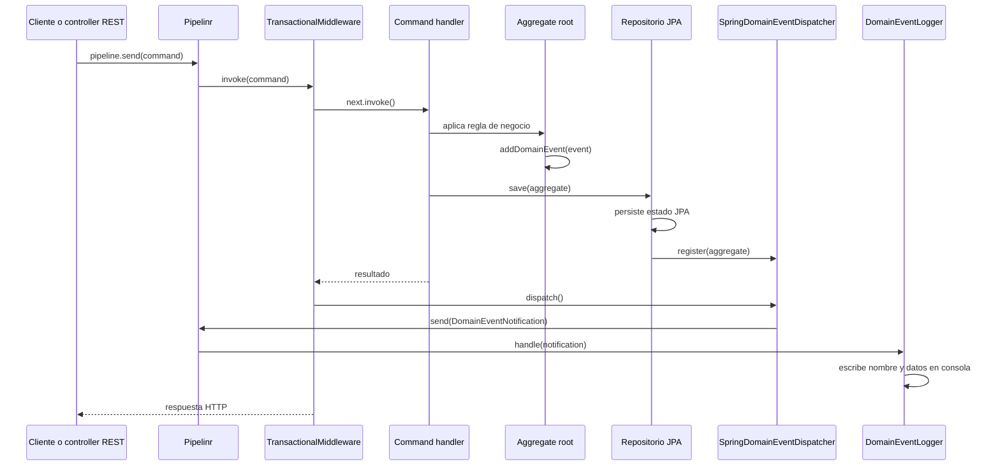
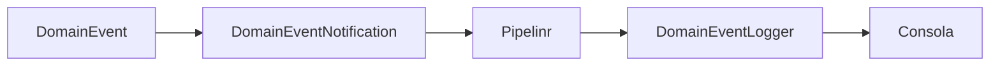
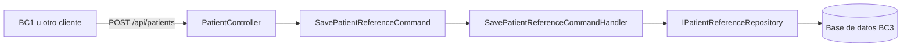

# Flujo actual de eventos de dominio

> Estado: implementado en el codigo actual. Este documento distingue el flujo
> interno existente de la integracion por broker propuesta en
> [`outbox-transaccional-bc3.md`](outbox-transaccional-bc3.md), que aun no esta
> implementada.

## Resumen

Los eventos de dominio de BC3 se originan dentro de los agregados
`Subscription` y `ConsolidatedCalendar`. Se guardan temporalmente en el propio
agregado, se publican de forma sincrona mediante Pipelinr y el unico consumidor
implementado es `DomainEventLogger`, que los escribe en la salida estandar.

No existen actualmente Kafka, RabbitMQ, una tabla outbox, un relay ni
consumidores de BC4 o BC5.

## Origen de los eventos

`AggregateRoot` hereda de `Entity`, que mantiene una lista privada de eventos.
Cada regla de negocio llama a `addDomainEvent(...)`; el evento no se publica en
ese momento.

| Agregado | Operacion | Evento emitido |
| --- | --- | --- |
| `Subscription` | `create(...)` | `SubscriptionCreated` |
| `Subscription` | `pause(...)` | `SubscriptionPaused` |
| `Subscription` | `reactivate(...)` | `SubscriptionReactivated` |
| `Subscription` | `modifyDeliveryDay(...)` | `DeliveryDayModified` |
| `Subscription` | `markNoDelivery(...)` | `DeliveryDayCancelled` |
| `Subscription` | `confirmDelivery(...)` | `DeliveryConfirmed` |
| `Subscription` | `registerFailedDelivery(...)` | `DeliveryFailed` |
| `Subscription` | `markEvaluationCompleted(...)` | `BiweeklyEvaluationCompleted` |
| `Subscription` | `complete()` | `SubscriptionCompleted` |
| `Subscription` | `cancel(...)` | `SubscriptionCancelled` |
| `ConsolidatedCalendar` | `create(...)` | `ConsolidatedCalendarCreated` |
| `ConsolidatedCalendar` | `close(...)` | `ConsolidatedCalendarClosed` |

Todos implementan `DomainEvent` y son `record` inmutables con `eventId` y
`occurredAt`.

No toda modificacion genera un evento. Por ejemplo, `updateDeliveryPreferences`
y `DeliveryDay.markAsConsolidated()` cambian estado pero no agregan un
`DomainEvent`.

## Publicacion interna

1. Un controller envia un comando al `Pipeline` de Pipelinr.
2. `TransactionalMiddleware` ejecuta el handler dentro de una transaccion
   Spring (`@Transactional`).
3. El handler invoca una operacion del agregado y luego llama a `save(...)`.
4. `JpaSubscriptionRepository` o `JpaConsolidatedCalendarRepository` persiste
   el agregado y lo registra en el `DomainEventDispatcher` de la peticion.
5. Al volver el handler, `TransactionalMiddleware` llama a `dispatch()`.
6. `SpringDomainEventDispatcher` recorre los eventos acumulados, envia un
   `DomainEventNotification` a Pipelinr y limpia la lista de eventos del
   agregado.

El dispatcher tiene alcance `@RequestScope`: cada peticion HTTP mantiene su
propia lista de agregados modificados.

## Consumidor implementado

`DomainEventLogger` es el unico `Notification.Handler<DomainEventNotification>`
del proyecto. Recibe todos los eventos sin discriminar por tipo y hace lo
siguiente:

1. Obtiene el nombre de la clase del evento, por ejemplo `DeliveryConfirmed`.
2. Imprime ese nombre y el contenido del evento en la consola.
3. No persiste datos adicionales.
4. No llama a otro servicio.
5. No publica en un broker.

Por tanto, los comentarios que indican que `ConsolidatedCalendarClosed` debe
activar Produccion (BC4) y Logistica (BC5) expresan una intencion de diseno,
pero esos consumidores no estan implementados.

## Caso: cierre del calendario consolidado

El cierre de un calendario usa `CloseConsolidatedCalendarCommandHandler` y
`DefaultDailyConsolidator`.

```mermaid
flowchart LR
    A["Comando de cierre"] --> B["CloseConsolidatedCalendarCommandHandler"]
    B --> C["DefaultDailyConsolidator"]
    C --> D["Busca Subscription activas"]
    D --> E["Selecciona DeliveryDay SCHEDULED"]
    E --> F["Crea ConsolidatedLine"]
    F --> G["Marca DeliveryDay como CONSOLIDATED"]
    G --> H["Guarda Subscription"]
    H --> I["Crea ConsolidatedCalendar"]
    I --> J["ConsolidatedCalendarCreated"]
    J --> K["Cierra el calendario"]
    K --> L["ConsolidatedCalendarClosed"]
    L --> M["Guarda calendario"]
    M --> N["Dispatcher"]
    N --> O["DomainEventLogger"]
```

Al guardar el calendario se registran sus dos eventos: el de creacion y el de
cierre. En cambio, las suscripciones modificadas durante la consolidacion se
registran sin eventos, porque marcar un dia como `CONSOLIDATED` no los emite.

## Entrada de referencias de paciente

El proyecto mantiene `PatientReference`, una proyeccion local del estado del
paciente. En el codigo actual la entrada es HTTP, no un consumidor de broker.

`SavePatientReferenceCommandHandler` persiste `patientId`, `active` y
`updatedAt`. No emite ni consume un `DomainEvent`.

## Limites de consistencia actuales

`dispatch()` se ejecuta dentro de `TransactionalMiddleware`, antes de que
Spring complete el commit de la transaccion. Como consecuencia:

- Los handlers de eventos se ejecutan en la misma peticion e hilo.
- Un fallo de un handler podria hacer fallar la operacion y provocar rollback.
- La publicacion no es durable frente a una caida del proceso.
- No existe una garantia de entrega para otros bounded contexts.

La solucion prevista para integracion externa es el patron Transactional Outbox,
documentado en [`outbox-transaccional-bc3.md`](outbox-transaccional-bc3.md).
Ese diseno separa el evento de dominio interno del evento de integracion publico
y permite publicar despues del commit mediante un relay.

## Archivos relevantes

| Archivo | Responsabilidad |
| --- | --- |
| `domain/src/main/java/com/mcalvaro/mscatering/domain/core/Entity.java` | Almacena y expone los eventos pendientes. |
| `domain/src/main/java/com/mcalvaro/mscatering/domain/subscription/Subscription.java` | Emite los eventos de suscripcion. |
| `domain/src/main/java/com/mcalvaro/mscatering/domain/consolidatedcalendar/ConsolidatedCalendar.java` | Emite los eventos de calendario consolidado. |
| `infrastructure/src/main/java/com/mcalvaro/mscatering/infrastructure/persistence/subscription/repository/JpaSubscriptionRepository.java` | Persiste y registra `Subscription`. |
| `infrastructure/src/main/java/com/mcalvaro/mscatering/infrastructure/persistence/consolidatedcalendar/repository/JpaConsolidatedCalendarRepository.java` | Persiste y registra `ConsolidatedCalendar`. |
| `infrastructure/src/main/java/com/mcalvaro/mscatering/infrastructure/config/TransactionalMiddleware.java` | Abre la transaccion y desencadena el dispatch. |
| `infrastructure/src/main/java/com/mcalvaro/mscatering/infrastructure/unitofwork/SpringDomainEventDispatcher.java` | Convierte eventos pendientes en notificaciones Pipelinr. |
| `infrastructure/src/main/java/com/mcalvaro/mscatering/infrastructure/events/DomainEventLogger.java` | Unico consumidor implementado; registra eventos en consola. |
| `infrastructure/src/main/java/com/mcalvaro/mscatering/infrastructure/api/patient/PatientController.java` | Entrada HTTP para actualizar `PatientReference`. |
