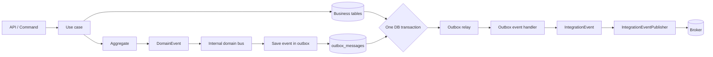
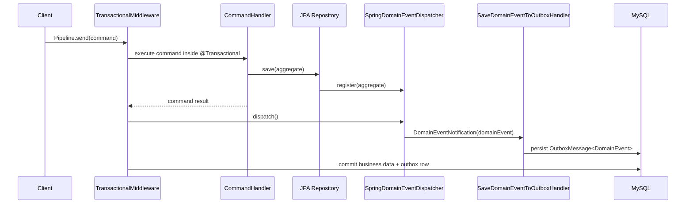
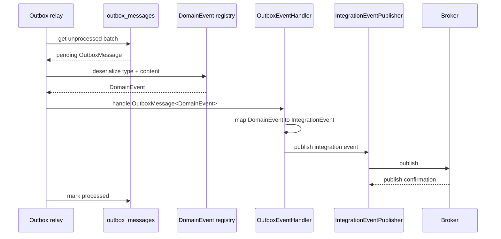

# Outbox Transaccional de BC3

> Estado: arquitectura pendiente de implementacion. Los contratos externos v1
> estan congelados en [Contratos de Integracion de Salida BC3 v1](outbox/contratos-integracion-salida-v1.md).
> Solo `OUT-002A` esta implementado en el dominio; no hay outbox, relay, broker,
> proyecciones BC1/BC2, snapshots de alta (`OUT-002B`) ni recetas cerradas (`OUT-002C`).

BC3 necesitara aplicar el patron **Transactional Outbox** para publicar hechos de negocio sin incurrir en el problema de dual-write. La solucion conserva los eventos de dominio dentro de BC3 y solo publica al broker eventos de integracion.

El plan ejecutable, orden de dependencias y criterios de cierre estan en el [backlog de implementacion](outbox/tickets-implementacion.md). Los nombres publicos, payloads, IDs y destinos logicos no se deciden en este documento: los define el contrato v1 congelado.

## Decision principal

Un `DomainEvent` y un `IntegrationEvent` son conceptos distintos y no deben intercambiarse:

| Concepto | Donde vive | Alcance | Se envia al broker |
| --- | --- | --- | --- |
| `DomainEvent` | `domain/` | Describe un cambio dentro de BC3 | No |
| `OutboxMessage<DomainEvent>` | Persistencia de BC3 | Conserva de forma durable un evento de dominio pendiente | No |
| `IntegrationEvent` | Modulo de contratos compartidos | Contrato publico para otros bounded contexts | Si |

El outbox persiste el `DomainEvent`. Cuando un proceso relay lo recupera, un handler lo traduce en el `IntegrationEvent` correspondiente y lo publica mediante un adaptador de mensajeria.

## Flujo resumido



La primera mitad del diagrama es atomica: el cambio de negocio y la fila del outbox se confirman juntos o se revierten juntos. La segunda mitad es asincrona y se activa cuando se haya elegido RabbitMQ o Kafka.

## Problema que resuelve

Sin outbox, una operacion tiene dos escrituras independientes:

```text
1. Persistir suscripcion/calendario en MySQL
2. Publicar evento en el broker
```

Si el proceso falla entre ambas, BC3 conserva el cambio pero el resto de servicios nunca recibe el evento. Si se publica antes y luego la transaccion revierte, los consumidores reciben un hecho que no ocurrio.

Con el outbox, la primera escritura se reemplaza por una sola transaccion de base de datos:

```text
INSERT/UPDATE business tables
INSERT outbox_messages
COMMIT
```

Un fallo de broker no pierde el evento: la fila permanece pendiente para un reintento posterior. La garantia resultante es **at-least-once**; un consumidor debe ser idempotente cuando se implemente la fase de consumo.

## Flujo transaccional en BC3

La estructura actual ya contiene los puntos necesarios:

| Componente actual | Responsabilidad futura |
| --- | --- |
| `Subscription` y `ConsolidatedCalendar` | Emiten eventos de dominio inmutables. |
| `JpaSubscriptionRepository` y `JpaConsolidatedCalendarRepository` | Guardan el agregado y lo registran en `DomainEventDispatcher`. |
| `TransactionalMiddleware` | Abre la transaccion Spring de cada comando y ejecuta el dispatcher antes del commit. |
| `SpringDomainEventDispatcher` | Envia `DomainEventNotification` por Pipelinr. |
| `SaveDomainEventToOutboxHandler` | Nuevo handler interno: crea y agrega la fila outbox al mismo contexto JPA. |
| `DomainEventLogger` | Deja de ser mecanismo de integracion; puede conservarse solo como diagnostico. |

La secuencia concreta sera:



No se debe llamar al publisher externo desde `TransactionalMiddleware`, desde un command handler ni desde un handler de dominio. Todos esos puntos ocurren antes del commit y reintroducirian el dual-write.

## Modelo de persistencia

La tabla propuesta se llamara `outbox_messages`. La migracion se agregara a Liquibase y se incluira desde `db.changelog-master.yaml`.

| Columna | Tipo orientativo | Proposito |
| --- | --- | --- |
| `id` | `CHAR(36)` | Identificador unico del mensaje; reutiliza `DomainEvent.eventId()`. |
| `type` | `VARCHAR` | Tipo logico y versionado del evento de dominio serializado. |
| `content` | `TEXT` | JSON del `DomainEvent`. |
| `created` | `TIMESTAMP` | Instante de registro en el outbox. |
| `processed` | `BOOLEAN` | Indica si el relay publico exitosamente el evento. |
| `processed_on` | `TIMESTAMP NULL` | Momento en que se confirmo la publicacion. |
| `correlation_id` | `VARCHAR NULL` | Identificador de la operacion transversal. |
| `trace_id` | `VARCHAR NULL` | Trazabilidad distribuida futura. |
| `span_id` | `VARCHAR NULL` | Trazabilidad distribuida futura. |

`content` guarda un evento de dominio, nunca el JSON de un evento de integracion.

### Serializacion y rehidratacion

La rehidratacion debe usar un registro explicito de tipos permitidos:

```text
subscription.created                -> SubscriptionCreated
subscription.paused                 -> SubscriptionPaused
subscription.reactivated            -> SubscriptionReactivated
subscription.cancelled              -> SubscriptionCancelled
subscription.completed              -> SubscriptionCompleted
consolidated-calendar.closed        -> ConsolidatedCalendarClosed
```

No se debe deserializar una clase arbitraria a partir de un nombre de clase recibido desde la base de datos. El registro restringe los tipos validos, evita acoplar la persistencia a nombres Java y permite versionar el formato de cada evento.

## Eventos que BC3 llevara al outbox

BC3 solo guardara en el outbox los eventos de dominio que tienen una contraparte de integracion definida.

| Evento de dominio | Evento de integracion | Destino logico v1 | Consumidores |
| --- | --- | --- | --- |
| `SubscriptionCreated` | `bc3.SuscripcionCreada` | `bc3.suscripcion.creada.v1` | MsPatientsConsulCore |
| `SubscriptionPaused` | `bc3.SuscripcionPausada` | `bc3.suscripcion.pausada.v1` | MsPatientsConsulCore, MsNotificaciones |
| `SubscriptionReactivated` | `bc3.SuscripcionReactivada` | `bc3.suscripcion.reactivada.v1` | MsPatientsConsulCore, MsNotificaciones |
| `SubscriptionCancelled` | `bc3.SuscripcionCancelada` con `tipoBaja=MANUAL` | `bc3.suscripcion.cancelada.v1` | MsPatientsConsulCore, MSNutritionPlanner, MsNotificaciones |
| `SubscriptionCompleted` | `bc3.SuscripcionCancelada` con `tipoBaja=VENCIMIENTO` | `bc3.suscripcion.cancelada.v1` | MsPatientsConsulCore, MSNutritionPlanner, MsNotificaciones |
| `ConsolidatedCalendarClosed` | `bc3.CalendarioConsolidadoCerrado` | `bc3.calendario-consolidado.cerrado.v1` | MsProductionPackaging |

Los eventos `DeliveryDayModified`, `DeliveryDayCancelled`, `DeliveryConfirmed`, `DeliveryFailed` y `BiweeklyEvaluationCompleted` siguen siendo internos en esta fase. En particular, una confirmacion de entrega debera entrar en BC3 como evento de integracion de BC5 cuando se implementen consumers; BC3 no debe publicar un hecho cuyo productor de negocio es Logistica.

## Contratos de integracion de salida

El contrato congelado de OUT-001 es [Contratos de Integracion de Salida BC3 v1](outbox/contratos-integracion-salida-v1.md), junto con sus [schemas Draft 2020-12](outbox/schemas/v1/). Sustituye cualquier decision provisional de este documento sobre envelope, payload, representacion de IDs, destinatarios y destinos.

Los identificadores de negocio en `data` son UUID serializados como texto, por decision aprobada para v1; no usan codigos con prefijo. Los cinco `eventName` publicos conservan exactamente los valores espanoles definidos en el contrato. Los futuros tipos y archivos Java, cuando se implementen, se nombraran en ingles y no alteraran el wire contract.

Los contratos viviran fuera de `domain/`, en un modulo Maven sin Spring, JPA ni dependencias de infraestructura. Cuando exista un SharedKernel comun del equipo, este modulo debera moverse o publicarse alli.

## Relay y traduccion a integracion

El relay sera un proceso de infraestructura. Su responsabilidad no es conocer detalles de negocio ni decidir el formato publico; se limita a recuperar filas no procesadas y despachar su evento de dominio rehidratado.



En .NET, MediatR puede despachar `OutboxMessage<ProductCreated>` usando el tipo generico concreto. En Java, el type erasure impide depender de esa resolucion generica en tiempo de ejecucion. La adaptacion recomendada es un registro explicito de handlers:

```java
public interface OutboxEventHandler<E extends DomainEvent> {
    Class<E> eventType();
    void handle(OutboxMessage<E> message);
}
```

El procesador busca el handler por el tipo de dominio rehidratado. Cada handler crea un contrato de integracion y usa el puerto `IntegrationEventPublisher`.

Ejemplos previstos:

```text
OutboxMessage<SubscriptionCreated>
  -> PublishSubscriptionCreated
  -> bc3.SuscripcionCreada

OutboxMessage<ConsolidatedCalendarClosed>
  -> PublishConsolidatedCalendarClosed
  -> bc3.CalendarioConsolidadoCerrado
```

## Adaptadores de mensajeria

La eleccion de broker queda fuera de la primera implementacion. El relay dependera de este puerto:

```java
public interface IntegrationEventPublisher {
    void publish(IntegrationEvent event);
}
```

En una fase posterior se registrara exactamente una implementacion:

| Adaptador | Responsabilidad |
| --- | --- |
| `RabbitMqIntegrationEventPublisher` | Serializa el `IntegrationEvent`, publica en el exchange y espera confirmacion del broker. |
| `KafkaIntegrationEventPublisher` | Serializa el `IntegrationEvent`, publica en el topic y espera confirmacion del productor. |

La configuracion inicial debe mantener el relay desactivado. Sin un adaptador de broker, ningun mensaje puede marcarse como procesado.

```yaml
messaging:
  provider: none # none, rabbitmq, kafka
  outbox:
    relay-enabled: false
    poll-interval: 5s
    batch-size: 20
```

## Datos que deben estar en el DomainEvent

Como el outbox persiste eventos de dominio y los eventos se traducen despues, cada `DomainEvent` debe contener un snapshot inmutable suficiente para construir su contrato de integracion. El relay no debe leer el estado actual del agregado para completar el mensaje: ese estado podria haber cambiado desde que ocurrio el evento.

El proyecto tiene estas brechas antes de habilitar la publicacion real:

| Evento | Brecha actual | Decision requerida |
| --- | --- | --- |
| `SubscriptionCreated` | No contiene todos los datos de contrato que el mensaje externo necesita. | Enriquecer el evento de dominio con el snapshot de plan, vigencia, precio y datos acordados. |
| `SubscriptionPaused` | La pausa actual no extiende de forma efectiva la vigencia ni agrega entregas sustitutas. | Corregir la regla de dominio antes de emitir `nuevaFechaFin`. |
| `SubscriptionReactivated` | Debe reflejar el estado y la fecha de vigencia realmente calculados. | Enriquecer el snapshot cuando se corrija la regla de pausa. |
| `SubscriptionCancelled` | Debe distinguir cancelacion manual de vencimiento. | Mapear `SubscriptionCompleted` a `tipoBaja=VENCIMIENTO`. |
| `ConsolidatedCalendarClosed` | Solo contiene id, fecha y total; no contiene lineas, recetas ni porciones. | Incorporar el read model de planes/recetas de BC2 y capturar las lineas completas en el evento. |

La informacion no debe agregarse al `IntegrationEvent` antes de persistir el outbox. Debe estar ya capturada por el `DomainEvent` que se guarda en la misma transaccion.

## Estructura propuesta

```text
domain/
  .../event/
    SubscriptionCreated.java
    SubscriptionPaused.java
    SubscriptionReactivated.java
    SubscriptionCancelled.java
    SubscriptionCompleted.java
    ConsolidatedCalendarClosed.java

application/
  .../abstractions/
    DomainEventNotification.java
    DomainEventDispatcher.java
    IntegrationEventPublisher.java
  .../outbox/
    OutboxMessage.java
    OutboxService.java
    OutboxEventHandler.java
  .../outbox/handlers/
    PublishSubscriptionCreated.java
    PublishSubscriptionPaused.java
    PublishSubscriptionReactivated.java
    PublishSubscriptionCancelled.java
    PublishConsolidatedCalendarClosed.java

integration-contracts/
  .../bc3/
    IntegrationEvent.java
    SubscriptionCreatedIntegrationEvent.java
    SubscriptionPausedIntegrationEvent.java
    SubscriptionReactivatedIntegrationEvent.java
    SubscriptionCancelledIntegrationEvent.java
    ConsolidatedCalendarClosedIntegrationEvent.java

infrastructure/
  .../persistence/outbox/
    OutboxMessageJpaEntity.java
    JpaOutboxRepository.java
    OutboxMessageMapper.java
    DomainEventCodec.java
  .../outbox/
    OutboxProcessor.java
    OutboxRelay.java
    OutboxEventHandlerRegistry.java
  .../messaging/
    RabbitMqIntegrationEventPublisher.java  # fase posterior
    KafkaIntegrationEventPublisher.java     # fase posterior
```

El modulo `domain/` sigue siendo Java puro. No recibe dependencias de Spring, JPA, Pipelinr ni del broker.

## Pruebas de aceptacion

### Persistencia atomica

- Crear una suscripcion debe persistir la suscripcion y una fila outbox de `SubscriptionCreated`.
- Si el comando revierte, no debe existir ni cambio de negocio ni fila outbox.
- Un evento de dominio no expuesto hacia otros servicios no debe crear una fila outbox.

### Procesamiento

- El procesador debe rehidratar el tipo de dominio registrado correctamente.
- Cada `OutboxEventHandler` debe traducir el evento de dominio al contrato de integracion esperado.
- Si el publisher lanza una excepcion, `processed` debe seguir siendo `false`.
- Si la publicacion se confirma, el mensaje debe quedar con `processed=true` y `processedOn` informado.

### Contratos

- El JSON de cada `IntegrationEvent` debe cumplir el envelope comun y una version explicita.
- Los eventos de integracion no deben filtrar entidades JPA ni tipos internos de dominio.
- Los datos deben corresponder al snapshot persistido en el outbox, no al estado actual de la base de datos.

## Limites de la primera fase

- No se agrega RabbitMQ ni Kafka.
- No se crean exchanges, topics, colas ni consumers.
- No se implementa inbox ni deduplicacion de mensajes entrantes.
- No se habilita el `OutboxRelay` en produccion.
- No se marca una fila como procesada sin una confirmacion del adaptador de mensajeria.

## Siguiente orden de trabajo

1. Implementar el modelo y migracion del outbox.
2. Agregar el handler interno que persiste `DomainEvent` en la misma transaccion.
3. Crear el registro seguro de serializacion y rehidratacion de eventos de dominio.
4. Definir y probar los cinco handlers `DomainEvent -> IntegrationEvent`.
5. Enriquecer los eventos de dominio que todavia no contienen el snapshot requerido.
6. Elegir RabbitMQ o Kafka e implementar un unico adaptador de `IntegrationEventPublisher`.
7. Activar el relay, agregar reintentos y finalmente implementar consumers idempotentes.
