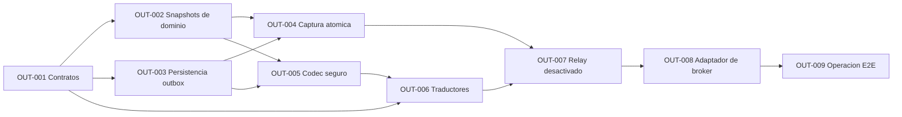

# Backlog De Implementacion: Transactional Outbox BC3

> Estado: `OUT-001` completado (solo documentacion) y `OUT-002A` completado
> (correlacion, snapshots de pausa/reactivacion/baja y reglas de calendario).
> `OUT-002B`, `OUT-002C` y `OUT-003` a `OUT-009` siguen planificados. Este
> backlog implementa el diseno de [Outbox Transaccional de BC3](../outbox-transaccional-bc3.md).

## Objetivo de entrega

Al cerrar `OUT-009`, BC3 debe publicar de forma confiable sus eventos salientes: un cambio de negocio y su `DomainEvent` se persisten en una unica transaccion; un relay transforma el evento persistido en un `IntegrationEvent`; y el evento se publica mediante el broker seleccionado.

La implementacion conserva esta frontera obligatoria:

```text
Aggregate -> DomainEvent -> OutboxMessage<DomainEvent> -> relay
          -> IntegrationEvent -> IntegrationEventPublisher -> broker
```

Un `DomainEvent` nunca se publica directamente y un `IntegrationEvent` nunca se persiste en el outbox.

## Reglas comunes para todos los tickets

- `domain/` sigue siendo Java puro: sin Spring, JPA, Pipelinr ni librerias de mensajeria.
- El outbox contiene solo los seis eventos de dominio definidos como salientes.
- Los eventos internos no generan filas de outbox.
- Ningun publisher externo se invoca dentro de la transaccion de un comando.
- Los payloads de integracion se construyen a partir del snapshot persistido, no leyendo el estado actual de la base de datos.
- Los cambios de cada ticket incluyen pruebas en el modulo apropiado y no rompen `mvn test` desde la raiz.
- La activacion del relay requiere un publisher real configurado; hasta ese momento, queda deshabilitado por defecto.

## Orden de ejecucion



| Fase | Ticket | Resultado verificable |
| --- | --- | --- |
| 0 | `OUT-001` | Completado: [contratos externos v1 y schemas](contratos-integracion-salida-v1.md) congelados. |
| 0 | `OUT-002` | Eventos de dominio con snapshots suficientes y reglas corregidas. |
| 1 | `OUT-003` | Tabla, entidad y repositorio de outbox operativos. |
| 1 | `OUT-004` | Evento saliente persistido atomica y selectivamente. |
| 1 | `OUT-005` | Codec seguro para serializar y rehidratar eventos. |
| 2 | `OUT-006` | Contratos Java y traductores de dominio a integracion. |
| 3 | `OUT-007` | Relay probado pero apagado por configuracion. |
| 4 | `OUT-008` | Publicacion real en el broker elegido. |
| 4 | `OUT-009` | Operacion observable, resistente y validada end-to-end. |

## OUT-001: Congelar contratos y reglas de integracion - COMPLETADO

**Artefacto de cierre**: [Contratos de Integracion de Salida BC3 v1](contratos-integracion-salida-v1.md) y [schemas JSON Schema Draft 2020-12](schemas/v1/). Esta entrega es documental: no crea productores, persistencia, relay ni configuracion de broker.

**Objetivo**: convertir los acuerdos funcionales de los documentos del curso en contratos versionados, sin iniciar aun persistencia ni mensajeria.

**Alcance**

- Definir el envelope comun: `eventId`, `eventName`, `eventVersion`, `occurredOn`, `source`, `correlationId` y `data`.
- Definir el payload exacto de `bc3.SuscripcionCreada`, `bc3.SuscripcionPausada`, `bc3.SuscripcionReactivada`, `bc3.SuscripcionCancelada` y `bc3.CalendarioConsolidadoCerrado`.
- Confirmar destinos, routing key o topic logico, version inicial y politica de compatibilidad de cada evento.
- Establecer los mapeos de `SubscriptionCancelled` y `SubscriptionCompleted` hacia `bc3.SuscripcionCancelada` con valores distintos de `tipoBaja`.
- Fijar la representacion aprobada: todos los IDs de negocio en `data` son UUID serializados como texto.
- Crear la matriz de campos `DomainEvent -> IntegrationEvent`, indicando el origen de cada campo y si requiere enriquecer el dominio.

**Fuera de alcance**

- Crear productores, tablas, migraciones o configuracion de broker.
- Decidir detalles de infraestructura de RabbitMQ o Kafka.

**Entregables**

- Documento de contratos y matriz de mapeo en `docs/outbox/`.
- Esquemas JSON o ejemplos JSON completos para cada evento publico.
- Lista cerrada de los seis eventos de dominio que pueden entrar al outbox.

**Criterios de aceptacion**

- Cada campo de cada contrato tiene nombre, tipo, obligatoriedad y origen definidos.
- Cada `eventName` tiene una unica version inicial y un unico propietario: BC3.
- `SubscriptionCompleted` se traduce en una baja por vencimiento y no expone un evento adicional ambiguo.
- Los contratos no incluyen clases Java, entidades JPA ni value objects internos.
- Los destinos se expresan de forma independiente del broker para no acoplar la decision a RabbitMQ o Kafka.

**Riesgo que elimina**: implementar DTOs o enriquecer eventos de dominio contra supuestos que otros bounded contexts no consumiran.

## OUT-002: Enriquecer snapshots y completar reglas de dominio

**Estado parcial**: `OUT-002A` completado. `OUT-002B` (snapshot de alta con
tipo de plan/factura) y `OUT-002C` (snapshot de calendario cerrado con recetas)
no estan implementados. No existe aun outbox, relay, broker ni proyecciones BC1/BC2.

**Objetivo**: garantizar que el `DomainEvent` persistido contiene un snapshot inmutable y suficiente para crear el contrato externo despues de la transaccion.

**Alcance**

- Extender `SubscriptionCreated` con los datos de contrato aprobados: paciente, plan, vigencia, direccion, preferencias, precio y demas campos acordados.
- Extender `SubscriptionPaused` y `SubscriptionReactivated` con las fechas finales resultantes y las modificaciones de calendario necesarias.
- Mantener `SubscriptionCancelled` como baja manual y modelar la conversion de `SubscriptionCompleted` a baja por vencimiento en el traductor.
- Extender `ConsolidatedCalendarClosed` con las lineas requeridas por BC4 cuando el read model de planes y recetas de BC2 este disponible.
- Corregir la regla de pausa para que la vigencia y las entregas sustitutas reflejen el resultado comunicado externamente.
- Actualizar pruebas de los aggregates y eventos afectados.

**Fuera de alcance**

- Persistir el outbox o publicar mensajes.
- Consultar el estado actual del agregado desde un relay futuro.

**Criterios de aceptacion**

- Un evento construido en el momento del cambio contiene todos los datos que necesitara su traductor.
- Ningun traductor futuro necesita llamar a un repositorio para completar el payload.
- Los snapshots permanecen inmutables tras cambios posteriores al agregado.
- Las pruebas de dominio cubren pausa, reactivacion, cancelacion y vencimiento con los valores publicados esperados.
- `mvn -pl domain test` finaliza correctamente.

**Riesgo que elimina**: publicar datos desactualizados o incompletos porque el relay se ejecute minutos despues de la operacion original.

## OUT-003: Modelo persistente y migracion de outbox

**Objetivo**: introducir la representacion durable del mensaje sin conectarla aun al flujo de comandos.

**Alcance**

- Crear el modelo de aplicacion `OutboxMessage<DomainEvent>` con estado y metadatos de trazabilidad.
- Crear `OutboxMessageJpaEntity`, mapper y repositorio de infraestructura.
- Agregar un changelog Liquibase para `outbox_messages` e incluirlo en `db.changelog-master.yaml`.
- Agregar indices para mensajes pendientes, disponibilidad, locks y limpieza de mensajes procesados.
- Incluir las columnas: `id`, `type`, `content`, `created`, `processed`, `processed_on`, `attempt_count`, `last_error`, `available_at`, `locked_until`, `locked_by`, `correlation_id`, `trace_id` y `span_id`.

**Decisiones tecnicas**

- `id` reutiliza `DomainEvent.eventId()` y evita crear un segundo identificador sin necesidad.
- `type` es un identificador logico versionable, nunca un nombre de clase Java.
- `content` es JSON del `DomainEvent`, nunca JSON del `IntegrationEvent`.
- `available_at` permite backoff sin retener el hilo de ejecucion.
- `locked_until` y `locked_by` impiden que dos instancias del relay procesen la misma fila al mismo tiempo.

**Criterios de aceptacion**

- Liquibase crea la tabla desde cero en H2 de pruebas y en el dialecto de produccion configurado.
- La entidad puede guardar y recuperar todos los campos sin perdida de precision temporal.
- Los indices soportan una consulta de mensajes pendientes y disponibles sin escanear mensajes procesados.
- Una prueba de repositorio cubre insercion, obtencion de pendientes y persistencia de metadatos de error.
- `mvn -pl infrastructure test` finaliza correctamente.

**Riesgo que elimina**: introducir un esquema minimo que no soporte reintentos, concurrencia u operacion diagnostica.

## OUT-004: Captura atomica de DomainEvent en el outbox

**Objetivo**: guardar eventos salientes y cambios de negocio dentro de la misma transaccion existente.

**Alcance**

- Implementar `SaveDomainEventToOutboxHandler` como handler interno de `DomainEventNotification`.
- Integrarlo con `SpringDomainEventDispatcher` y la frontera de `TransactionalMiddleware` sin publicar mensajes externos.
- Aplicar una lista explicita de tipos salientes; ignorar los eventos internos.
- Preservar `DomainEventLogger` solo como diagnostico o retirarlo del flujo de integracion.
- Propagar fallos de persistencia para que Spring revierta la transaccion completa.

**Criterios de aceptacion**

- Crear una suscripcion guarda la suscripcion y exactamente un `SubscriptionCreated` en el outbox.
- Un evento interno como `DeliveryConfirmed` no crea ninguna fila en el outbox.
- Si falla el insert de outbox, el agregado no queda persistido.
- Si el comando falla antes del commit, tampoco existe fila en `outbox_messages`.
- El evento se limpia del agregado solo despues de que el despacho interno finaliza sin error.
- Una prueba de integracion usa H2, Liquibase y la transaccion real de Spring.

**Riesgo que elimina**: dual-write entre la base de datos de BC3 y una futura publicacion externa.

## OUT-005: Codec seguro y registro de tipos de dominio

**Objetivo**: serializar y rehidratar exclusivamente los eventos de dominio permitidos por BC3.

**Alcance**

- Implementar `DomainEventCodec` con Jackson u otra serializacion ya aprobada por el proyecto.
- Registrar de forma explicita los tipos logicos: `subscription.created`, `subscription.paused`, `subscription.reactivated`, `subscription.cancelled`, `subscription.completed` y `consolidated-calendar.closed`.
- Exponer operaciones de serializacion, deserializacion y validacion de tipo.
- Manejar payload invalido o tipo desconocido como un fallo procesable, sin instanciar clases arbitrarias.

**Fuera de alcance**

- Implementar polimorfismo Jackson global con nombres de clases.
- Rehidratar eventos no publicados o tipos provenientes de datos no confiables.

**Criterios de aceptacion**

- Cada uno de los seis eventos puede hacer round-trip `DomainEvent -> JSON -> DomainEvent` sin perder datos.
- Un `type` desconocido genera un error descriptivo y no procesa la fila.
- Un JSON incompatible con su tipo logico genera un error descriptivo y no publica nada.
- El codec no depende de `Class.forName` ni de metadata de tipo introducida por el JSON.
- Las pruebas cubren cada tipo valido, tipo desconocido y JSON malformado.

**Riesgo que elimina**: acoplar datos persistidos a refactors de paquetes Java o abrir deserializacion insegura.

## OUT-006: Modulo de contratos y traductores de integracion

**Objetivo**: crear contratos publicos independientes de BC3 y transformar cada `DomainEvent` persistido en el mensaje externo correcto.

**Alcance**

- Crear el modulo Maven de contratos sin dependencias de Spring, JPA o infraestructura.
- Definir `IntegrationEvent` y los cinco contratos publicos acordados.
- Definir el puerto `IntegrationEventPublisher` en aplicacion.
- Implementar un `OutboxEventHandler<E extends DomainEvent>` por tipo saliente o por mapeo compartido cuando el contrato sea comun.
- Implementar el registro de handlers por `Class<E>` para evitar depender de genericos en tiempo de ejecucion.
- Crear el envelope y conservar `eventId`, `occurredOn` y correlacion del evento original.

**Mapeos obligatorios**

| Evento persistido | Contrato construido |
| --- | --- |
| `SubscriptionCreated` | `bc3.SuscripcionCreada` |
| `SubscriptionPaused` | `bc3.SuscripcionPausada` |
| `SubscriptionReactivated` | `bc3.SuscripcionReactivada` |
| `SubscriptionCancelled` | `bc3.SuscripcionCancelada` con `tipoBaja=MANUAL` |
| `SubscriptionCompleted` | `bc3.SuscripcionCancelada` con `tipoBaja=VENCIMIENTO` |
| `ConsolidatedCalendarClosed` | `bc3.CalendarioConsolidadoCerrado` |

**Criterios de aceptacion**

- Cada handler recibe un evento rehidratado y crea un contrato sin consultar repositorios.
- Cada JSON cumple el envelope y el esquema aprobado en `OUT-001`.
- El registro rechaza un evento sin handler y no permite dos handlers para el mismo tipo.
- Los contratos no exponen tipos de `domain/` ni clases de infraestructura.
- Las pruebas cubren todos los mapeos, incluidos cancelacion manual y vencimiento.

**Riesgo que elimina**: filtrar el modelo interno de BC3 o producir eventos semanticamente ambiguos.

## OUT-007: Relay de outbox con publicacion desactivada

**Objetivo**: construir y probar el proceso asincrono completo sin seleccionar aun un broker real.

**Alcance**

- Implementar `OutboxProcessor` para obtener un lote de mensajes disponibles, aplicar lock y procesarlos uno por uno.
- Implementar `OutboxRelay` programable de forma condicional mediante propiedades Spring.
- Rehidratar el evento con `DomainEventCodec` y delegar en `OutboxEventHandlerRegistry`.
- Marcar un mensaje como procesado solamente si `IntegrationEventPublisher` devuelve confirmacion exitosa.
- Registrar error, incrementar intentos, liberar o renovar lock y calcular `available_at` con backoff ante una falla.
- Mantener `messaging.provider=none` y `messaging.outbox.relay-enabled=false` como valores por defecto.
- Usar un publisher falso en pruebas; no agregar dependencias de RabbitMQ o Kafka.

**Criterios de aceptacion**

- Con relay deshabilitado, ningun proceso consume filas pendientes.
- Con publisher de prueba habilitado, un mensaje pendiente se traduce, publica y marca como procesado.
- Si el publisher falla, la fila conserva `processed=false`, incrementa sus intentos y guarda el error.
- Dos procesadores concurrentes no publican la misma fila mientras el lock sea valido.
- Un mensaje con `available_at` futuro no se selecciona antes de tiempo.
- El scheduler no inicia si no existe un publisher real o de prueba habilitado explicitamente.

**Riesgo que elimina**: activar mensajeria accidentalmente o perder trazabilidad cuando falle una publicacion.

## OUT-008: Adaptador para el broker seleccionado

**Objetivo**: conectar el puerto `IntegrationEventPublisher` a una unica tecnologia de mensajeria, sin cambiar dominio, outbox ni traductores.

**Precondicion**: el equipo debe haber elegido RabbitMQ o Kafka y aprobado destinos, seguridad y entorno local de desarrollo.

**Alcance**

- Implementar una unica clase: `RabbitMqIntegrationEventPublisher` o `KafkaIntegrationEventPublisher`.
- Agregar configuracion condicional para activar el adaptador elegido.
- Configurar serializacion del `IntegrationEvent`, destinos y confirmacion del broker.
- Propagar fallos de envio al relay para activar su mecanismo de reintentos.
- Proveer configuracion local y de pruebas sin credenciales incluidas en el repositorio.

**Criterios de aceptacion**

- Con `messaging.provider=none`, el adaptador y relay permanecen apagados.
- Con el proveedor elegido, el adapter publica el JSON contractual en el destino definido.
- Una confirmacion positiva permite marcar el mensaje como procesado.
- Un rechazo, timeout o indisponibilidad deja el mensaje pendiente para reintento.
- La prueba de integracion se ejecuta contra el broker real en contenedor o entorno controlado.

**Riesgo que elimina**: acoplar la logica de negocio al cliente del broker o considerar exitoso un envio no confirmado.

## OUT-009: Operacion, resiliencia y cierre end-to-end

**Objetivo**: dejar el flujo listo para operar, diagnosticar y evolucionar de forma segura.

**Alcance**

- Definir metricas de pendientes, procesados, fallos, reintentos, locks vencidos y antiguedad del mensaje pendiente mas antiguo.
- Incorporar logs estructurados con `eventId`, `type`, `correlationId` y numero de intento.
- Definir politica de retencion, archivado o limpieza de filas procesadas.
- Definir limite de reintentos, backoff, alerta y procedimiento para mensajes que superen el limite.
- Ejecutar pruebas end-to-end desde un comando de BC3 hasta la confirmacion del broker.
- Documentar configuracion operativa y procedimiento de recuperacion de mensajes pendientes.

**Criterios de aceptacion**

- Se puede identificar el estado de cualquier evento mediante su `eventId` y correlacion.
- Un reinicio de la aplicacion no pierde mensajes pendientes ni publica mensajes marcados como procesados.
- Una caida temporal del broker genera reintentos y recuperacion posterior sin intervencion manual.
- La limpieza no elimina filas pendientes ni filas bloqueadas validamente.
- Existe una prueba reproducible de fallo de broker, recuperacion y publicacion final.
- `mvn verify` finaliza correctamente, incluyendo las pruebas de infraestructura disponibles.

**Criterio de cierre del epic**: los seis eventos salientes definidos se almacenan atomica y selectivamente, se traducen sin leer estado mutable, se publican mediante el adaptador aprobado y quedan observables durante todo su ciclo de vida.

## Epic separado: Mensajeria entrante e Inbox

`MSG-010` no forma parte de la entrega del outbox saliente. Debe planificarse despues para recibir hechos de BC5, especialmente confirmaciones o fallos de entrega.

Su alcance incluira contrato entrante, tabla Inbox, deduplicacion por `eventId`, consumidor idempotente, reintentos y actualizacion de los aggregates de BC3. BC3 no debe publicar `DeliveryConfirmed` ni `DeliveryFailed`: esos hechos los produce el bounded context de Logistica.

## Definition Of Done del backlog

- `OUT-001` a `OUT-009` estan cerrados con sus pruebas correspondientes.
- El dominio sigue libre de dependencias de infraestructura.
- La transaccion del comando persiste el agregado y el mensaje outbox, o no persiste ninguno.
- Solo los eventos de dominio definidos como salientes generan mensajes.
- Solo eventos de integracion cruzan el adaptador de broker.
- El relay queda inactivo sin una configuracion de proveedor explicita.
- Los fallos temporales se pueden reintentar y diagnosticar sin perder mensajes.
- La documentacion de arquitectura y contratos coincide con el comportamiento probado.
