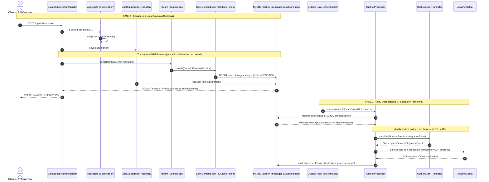

# Tutorial: Implementación del Patrón Transactional Outbox en ms-catering-subscription

> **Audiencia**: Desarrolladores y arquitectos de software.  
> **Proyecto**: `ms-catering-subscription` (BC3 - Bounded Context de Suscripciones y Catering).  
> **Stack**: Java 21, Spring Boot 4 / 3.x, Spring Data JPA, MySQL 8.4, Apache Kafka (KRaft), Pipelinr.

---

## 1. Fundamentos: El Problema del Dual-Write en Microservicios

En una arquitectura de microservicios orientada a eventos (Event-Driven Architecture), un caso de uso común consiste en modificar el estado del negocio (por ejemplo, dar de alta una suscripción) y notificar al resto del ecosistema mediante un broker de eventos (Apache Kafka).

El enfoque ingenuo suele verse así:

```java
// ANTIPATRÓN: DUAL-WRITE DIRECTO
@Transactional
public void crearSuscripcion(CreateSubscriptionCommand cmd) {
    Subscription sub = Subscription.create(...);
    subscriptionRepository.save(sub); // 1. Escritura en MySQL

    kafkaTemplate.send("bc3.catering.eventos", new SuscripcionCreadaEvent(...)); // 2. Escritura en Kafka
}
```

### ¿Por qué este enfoque está ROTO por diseño?

Existen dos fallas distribuidas inevitables:

1. **Fallo en Kafka tras commit en BD (Evento Perdido)**: Si la base de datos confirma (`COMMIT`), pero Kafka no responde, hay timeout de red o el broker cae, la suscripción existe en MySQL pero ningún otro servicio (Nutrición, Logística, Facturación) se enterará jamás de su creación.
2. **Fallo en BD tras publicación en Kafka (Evento Fantasma)**: Si publicamos en Kafka primero y luego el `COMMIT` en MySQL falla por constraint de base de datos o corte de red, el broker ya distribuyó el evento a los consumidores para una suscripción que nunca existió.
3. **¿Por qué no usar Two-Phase Commit (2PC / XA)?**: Los protocolos 2PC introducen bloqueos distribuidos de alta latencia, penalizan severamente el throughput y Kafka no soporta transacciones XA distribuidas junto a MySQL.

### La Solución: Transactional Outbox Pattern

En lugar de escribir en dos sistemas heterogéneos, convertimos la intención de publicar en una fila dentro de una tabla dedicada en la **misma base de datos relacional** (`outbox_messages`), dentro de la **misma transacción ACID** local.

Posteriormente, un proceso desacoplado en segundo plano (**Outbox Relay**) lee los mensajes pendientes, los publica en Kafka con garantías y actualiza su estado. Esto proporciona una garantía formal de entrega **At-Least-Once** (al menos una vez).

---

## 2. Visión Arquitectónica y Separación de Conceptos

Una regla de diseño fundamental implementada en `ms-catering-subscription` es la **separación estricta entre Eventos de Dominio y Eventos de Integración**:

| Dimensión | `DomainEvent` | `OutboxMessage` | `IntegrationEvent` |
| :--- | :--- | :--- | :--- |
| **Ubicación** | Módulo `domain/` | Módulo `application/` y DB | Módulo `integration-contracts/` |
| **Audiencia** | Interna de BC3 | Persistencia interna BC3 | Pública para BC1, BC2, BC5, etc. |
| **Lenguaje** | Expresivo del modelo del dominio | Payload JSON opaco + metadatos | Esquema versionado y tipado |
| **¿Va a Kafka?**| **NO** (Bajo ninguna circunstancia) | **NO** | **SÍ** |

```
[ Agregado Domain ] 
        │ (emite DomainEvent)
        ▼
[ OutboxHandler ] ──── (serializa) ────► [ Tabla outbox_messages (MySQL) ]
                                                        │
                                    (polling con lease) │
                                                        ▼
                                                [ OutboxProcessor ]
                                                        │ (traduce a IntegrationEvent)
                                                        ▼
                                            [ Kafka Broker (bc3.catering.eventos) ]
```

---

## 3. Diagrama de Secuencia E2E

El patrón se ejecuta en dos fases claramente desacopladas:



---

## 4. Implementación Paso a Paso en el Código

### Paso 1: El Agregado emite el Evento de Dominio

El agregado de DDD es el guardián de invariantes y no sabe nada sobre bases de datos ni redes. Al crearse, registra el evento en su lista interna:

```java
// Ubicación: domain/src/main/java/com/mcalvaro/mscatering/domain/subscription/Subscription.java
public static Subscription create(
        SubscriptionId id,
        PatientId patientId,
        DietPlanId dietPlanId,
        PlanType planType,
        PlanDuration duration,
        SubscriptionPeriod period,
        List<EvaluationReference> evaluations,
        DeliveryAddressId addressId,
        DeliveryWindow deliveryWindow,
        String specialInstructions,
        Price totalPrice,
        Instant now,
        String correlationId) {

    // 1. Validaciones e invariantes de negocio...
    
    Subscription subscription = new Subscription(
            id, patientId, dietPlanId, planType, duration, period,
            SubscriptionStatus.ACTIVE, addressId, deliveryWindow,
            specialInstructions, totalPrice, evaluations, now, correlationId);

    // 2. Registro del evento de dominio inmutable
    subscription.recordEvent(new SubscriptionCreated(
            UUID.randomUUID(),
            id,
            patientId,
            dietPlanId,
            planType,
            duration.days(),
            period.startDate(),
            period.endDate(),
            evaluations.stream().map(EvaluationReference::evaluationId).toList(),
            totalPrice.amount(),
            now,
            correlationId));

    return subscription;
}
```

---

### Paso 2: Captura Transaccional del Evento hacia el Outbox

Cuando el caso de uso finaliza dentro de `@Transactional`, nuestro despachador interno (Pipelinr) envía el evento antes de que se haga `COMMIT` en la base de datos:

```java
// Ubicación: infrastructure/.../events/SaveDomainEventToOutboxHandler.java
@Component
public class SaveDomainEventToOutboxHandler implements Notification.Handler<DomainEventNotification> {

    private final JacksonDomainEventCodec codec;
    private final OutboxMessageRepository repository;

    public SaveDomainEventToOutboxHandler(JacksonDomainEventCodec codec, OutboxMessageRepository repository) {
        this.codec = codec;
        this.repository = repository;
    }

    @Override
    public void handle(DomainEventNotification notification) {
        DomainEvent event = notification.domainEvent();
        if (!codec.supports(event)) {
            return;
        }
        if (!(event instanceof CorrelatedDomainEvent correlatedEvent)) {
            throw new IllegalStateException("Supported domain event must implement CorrelatedDomainEvent");
        }

        // 1. Serializamos el evento a formato canónico JSON
        EncodedDomainEvent encoded = codec.encode(event);
        Instant capturedAt = Instant.now();

        // 2. Insertamos la fila en outbox_messages dentro de la misma transacción JDBC activa
        repository.save(new OutboxMessage(
                event.eventId(),
                encoded.type(),
                encoded.content(),
                capturedAt,
                false, // processed = false
                null,  // processedOn = null
                0,     // attemptCount = 0
                null,  // lastError = null
                capturedAt, // availableAt = now
                null,  // lockedUntil = null
                null,  // lockedBy = null
                correlatedEvent.correlationId(),
                null,  // traceId
                null   // spanId
        ));
    }
}
```

---

### Paso 3: Modelo de Persistencia de la Tabla `outbox_messages`

La entidad JPA representa la estructura de almacenamiento optimizada para lecturas por lotes y bloqueos distribuidos:

```java
// Ubicación: infrastructure/.../persistence/outbox/entity/OutboxMessageJpaEntity.java
@Entity
@Table(name = "outbox_messages")
public class OutboxMessageJpaEntity {

    @Id
    @Column(name = "id", nullable = false, updatable = false)
    private UUID id;

    @Column(name = "type", nullable = false, length = 128)
    private String type; // Ej: "com.mcalvaro.mscatering.domain.subscription.event.SubscriptionCreated"

    @Lob
    @Column(name = "content", nullable = false)
    private String content; // Payload JSON del evento de dominio

    @Column(name = "created", nullable = false)
    private Instant created;

    @Column(name = "processed", nullable = false)
    private boolean processed;

    @Column(name = "processed_on")
    private Instant processedOn;

    @Column(name = "attempt_count", nullable = false)
    private int attemptCount;

    @Lob
    @Column(name = "last_error")
    private String lastError;

    @Column(name = "available_at", nullable = false)
    private Instant availableAt; // Soporta Exponential Backoff

    @Column(name = "locked_until")
    private Instant lockedUntil; // Lease de bloqueo distribuido

    @Column(name = "locked_by", length = 128)
    private String lockedBy; // Token del worker que posee el lease

    @Column(name = "correlation_id", length = 255)
    private String correlationId;
    
    // Getters y setters...
}
```

---

### Paso 4: El Relay Poller y el Control de Concurrencia Distribuida

En producción podemos tener múltiples instancias de `ms-catering-subscription` corriendo en paralelo. ¿Cómo evitamos que dos instancias lean y publiquen el mismo mensaje al mismo tiempo?

#### 1. Bloqueo Optimista con Leases Atómicos (Compare-And-Swap)

En lugar de locks pesados en BD (`SELECT ... FOR UPDATE`), usamos una consulta SQL atómica con token de bloqueo:

```java
// Ubicación: infrastructure/.../persistence/outbox/repository/SpringDataOutboxMessageRepository.java
public interface SpringDataOutboxMessageRepository extends JpaRepository<OutboxMessageJpaEntity, UUID> {

    // 1. Busca mensajes pendientes cuya ventana de disponibilidad haya llegado y no estén bloqueados
    @Query("""
            select message from OutboxMessageJpaEntity message
            where message.processed = false
              and message.availableAt <= :now
              and (message.lockedUntil is null or message.lockedUntil <= :now)
            order by message.created asc, message.id asc
            """)
    List<OutboxMessageJpaEntity> findPendingAvailable(@Param("now") Instant now, Pageable pageable);

    // 2. Adquiere el lease de forma atómica: Solo 1 réplica logrará actualizar la fila (update count = 1)
    @Modifying(flushAutomatically = true, clearAutomatically = true)
    @Query("""
            update OutboxMessageJpaEntity message
            set message.lockedUntil = :leaseUntil, message.lockedBy = :lockToken
            where message.id = :id
              and message.processed = false
              and message.availableAt <= :now
              and (message.lockedUntil is null or message.lockedUntil <= :now)
            """)
    int claimIfAvailable(@Param("id") UUID id, @Param("now") Instant now,
            @Param("leaseUntil") Instant leaseUntil, @Param("lockToken") String lockToken);

    // 3. Marca como procesado solo si el worker actual aún posee el token
    @Modifying(flushAutomatically = true, clearAutomatically = true)
    @Query("""
            update OutboxMessageJpaEntity message
            set message.processed = true, message.processedOn = :processedOn,
                message.lockedUntil = null, message.lockedBy = null, message.lastError = null
            where message.id = :id and message.processed = false and message.lockedBy = :lockToken
            """)
    int markProcessedIfOwned(@Param("id") UUID id, @Param("lockToken") String lockToken,
            @Param("processedOn") Instant processedOn);
}
```

#### 2. El Procesador Central (`OutboxProcessor`)

> [!IMPORTANT]
> **Regla de Oro de Rendimiento**: La publicación a Kafka **NUNCA** debe ejecutarse dentro de una transacción de base de datos activa. Si Kafka se demora 3 segundos, mantendríamos un hilo de JDBC y una conexión de base de datos bloqueada innecesariamente.

```java
// Ubicación: infrastructure/.../outbox/OutboxProcessor.java
public void processAvailable(int batchSize, Duration leaseDuration) {
    Instant now = clock.instant();
    List<OutboxMessage> candidates = repository.findPendingAvailable(now, batchSize);
    for (OutboxMessage candidate : candidates) {
        processCandidate(candidate.id(), leaseDuration);
    }
}

private void processCandidate(UUID id, Duration leaseDuration) {
    Instant claimNow = clock.instant();
    String lockToken = UUID.randomUUID().toString(); // Token único de esta ejecución
    
    // Adquiere lease en TX aislada (REQUIRES_NEW)
    repository.tryClaim(id, claimNow, claimNow.plus(leaseDuration), lockToken)
            .ifPresent(message -> publishThenFinalize(message, lockToken));
}

private void publishThenFinalize(OutboxMessage message, String lockToken) {
    try {
        // 1. Traduce de DomainEvent -> IntegrationEvent
        IntegrationEvent integrationEvent = translators.translate(
                codec.decode(message.type(), message.content())
        );

        // 2. Publica en Kafka (Operación de red pura, SIN transacciones JDBC abiertas)
        publisher.publish(integrationEvent);

    } catch (Exception failure) {
        // 3. En caso de error: Reintento con Exponential Backoff
        Duration nextDelay = backoffFor(message.attemptCount(), initialBackoff, maxBackoff);
        repository.rescheduleAfterFailureIfOwned(
                message.id(), lockToken, clock.instant().plus(nextDelay), formatError(failure));
        return;
    }

    // 4. Marca como completado de forma definitiva
    try {
        repository.markProcessedIfOwned(message.id(), lockToken, clock.instant());
    } catch (Exception ignored) {
        // Si la marca falla pero ya se envió a Kafka, el lease expirará y se garantiza At-Least-Once
    }
}
```

---

### Paso 5: Traducción y Desacoplamiento (Anti-Corruption Layer)

Cada evento de dominio tiene su propio traductor registrado en `OutboxEventTranslatorRegistry`:

```java
// Ubicación: application/.../outbox/translation/SubscriptionCreatedOutboxEventTranslator.java
public final class SubscriptionCreatedOutboxEventTranslator 
        implements OutboxEventTranslator<SubscriptionCreated> {

    @Override
    public Class<SubscriptionCreated> sourceType() {
        return SubscriptionCreated.class;
    }

    @Override
    public SubscriptionCreatedIntegrationEvent translate(SubscriptionCreated source) {
        return new SubscriptionCreatedIntegrationEvent(
                source.eventId(),
                source.occurredAt(),
                source.correlationId(),
                new SubscriptionCreatedIntegrationEvent.Data(
                        source.subscriptionId().value(),    // Formato canónico "SUS-XXXXXXXX"
                        source.patientId().value(),         // "PAC-XXXX"
                        source.dietPlanId().value(),        // "PLAN-XXXX"
                        wirePlanType(source.planType()),    // "PERSONALIZADO" o "BASE"
                        source.durationDays(),
                        source.periodStart(),
                        source.periodEnd(),
                        source.evaluationIds().size(),
                        source.totalPrice(),
                        null // nroFactura inicial
                )
        );
    }
}
```

---

### Paso 6: Adaptador de Salida Kafka

El publicador envía el mensaje a Kafka de manera síncrona asegurando confirmación (`ack`) y añade las cabeceras requeridas por los consumidores:

```java
// Ubicación: infrastructure/.../integration/outbound/kafka/KafkaIntegrationEventPublisher.java
@Override
public void publish(IntegrationEvent event) {
    KafkaIntegrationEventRouter.Route route = router.route(event);
    String json = serialize(event);

    ProducerRecord<String, String> record = new ProducerRecord<>(route.topic(), route.key(), json);

    // Cabecera canónica esperada por consumidores como Gary en BC2
    record.headers().add("eventName", event.eventName().getBytes(StandardCharsets.UTF_8));

    try {
        // Bloqueo síncrono hasta que el cluster confirme la recepción (acks=all)
        kafkaTemplate.send(record).get(acknowledgementTimeout.toMillis(), TimeUnit.MILLISECONDS);
    } catch (ExecutionException exception) {
        throw new KafkaIntegrationEventPublishException("Kafka publication was rejected", exception.getCause());
    } catch (TimeoutException exception) {
        throw new KafkaIntegrationEventPublishException("Kafka publication acknowledgement timed out", exception);
    }
}
```

---

## 5. Configuración en `application.yml`

Toda la orquestación del Outbox se controla mediante propiedades declarativas en Spring Boot:

```yaml
# Ubicación: infrastructure/src/main/resources/application.yml
outbox:
  provider: ${OUTBOX_PROVIDER:kafka}
  relay-enabled: "${OUTBOX_RELAY_ENABLED:${KAFKA_ENABLED:false}}"
  poll-interval: 5s          # Frecuencia de ejecución del worker
  batch-size: 20             # Cantidad máxima de mensajes leídos por ciclo
  lease-duration: 1m         # Tiempo que un worker bloquea un mensaje
  initial-backoff: 5s        # Retardo inicial tras primer error
  max-backoff: 5m            # Retardo máximo entre reintentos

spring:
  kafka:
    producer:
      acks: all              # Garantía de durabilidad total en el broker
      properties:
        "[enable.idempotence]": true
        "[max.block.ms]": 5000
```

---

## 6. Verificación en Vivo y Demostración Práctica

### 1. Inspeccionar la Tabla Outbox en MySQL

Al crear una suscripción desde la API (`POST http://localhost:8083/api/subscriptions`), podemos verificar cómo queda el registro en MySQL:

```bash
docker compose exec ms-catering-db mysql -uadmin_db -p123456 -D ms_catering_subscription -e \
  "SELECT id, type, processed, processed_on, attempt_count, locked_by FROM outbox_messages\G"
```

**Salida de ejemplo:**
```text
*************************** 1. row ***************************
           id: 516b38f8-cdca-4833-80c4-9d23fc488afa
         type: com.mcalvaro.mscatering.domain.subscription.event.SubscriptionCreated
    processed: 1
 processed_on: 2026-10-31 14:31:19
attempt_count: 0
    locked_by: NULL
```

### 2. Verificar el Evento Publicado en Kafka

Escuchando el tópico `bc3.catering.eventos`:

```bash
docker exec -it ms-catering-kafka /opt/kafka/bin/kafka-console-consumer.sh \
  --bootstrap-server localhost:9092 \
  --topic bc3.catering.eventos \
  --property print.headers=true \
  --from-beginning
```

**Mensaje recibido:**
```json
eventName:bc3.SuscripcionCreada	{
  "eventId": "516b38f8-cdca-4833-80c4-9d23fc488afa",
  "eventName": "bc3.SuscripcionCreada",
  "eventVersion": "1.0",
  "occurredOn": "2026-10-31T10:31:18-04:00",
  "correlationId": "d2af74c8-d313-461a-9b0c-7724f888d4ab",
  "source": "MsCateringSubscription",
  "data": {
    "idSuscripcion": "SUS-0E762997",
    "idPaciente": "PAC-1024",
    "idPlan": "PLAN-205",
    "tipoPlan": "PERSONALIZADO",
    "duracionDias": 15,
    "fechaInicio": "2026-11-01",
    "fechaFin": "2026-11-15",
    "evaluacionesIncluidas": 1,
    "montoFacturado": 250.0,
    "nroFactura": null,
    "moneda": "BOB"
  }
}
```

---

## 7. Preguntas Frecuentes de Arquitectura para Defensas

### P1: ¿Qué pasa si el servidor se apaga justo después de publicar en Kafka pero antes de marcar `processed = true`?
> **Respuesta del Arquitecto**: Al caerse el proceso, el `locked_until` (lease de 1 minuto) expirará. Cuando el servicio vuelva a levantar o una réplica hermana tome el control, encontrará el mensaje con `processed = false` y volverá a publicarlo en Kafka.  
> Esto demuestra que el patrón Outbox garantiza **At-Least-Once Delivery** (al menos una vez), **no Exactly-Once**. Por ello, es mandatorio que los microservicios consumidores implementen idempotencia basándose en `eventId` o `idSuscripcion`.

### P2: ¿Por qué no usamos Debezium (Change Data Capture / CDC)?
> **Respuesta del Arquitecto**: Debezium/CDC es excelente para sistemas de muy alto volumen, pero requiere infraestructura adicional (Kafka Connect, Zookeeper/Strimzi, acceso a binlogs de MySQL con privilegios de replicación). El enfoque de **Polling Publisher con Lease Optimista** es autosuficiente, corre dentro de la misma aplicación, no requiere brokers auxiliares y ofrece control total de traducción de eventos a nivel de código de aplicación.

### P3: ¿Por qué traducir de `DomainEvent` a `IntegrationEvent` en lugar de guardar directamente el JSON final?
> **Respuesta del Arquitecto**: Si guardamos el `IntegrationEvent` directamente en la base de datos, acoplamos la persistencia interna de nuestro dominio a un contrato público externo. Si mañana el equipo acuerda una versión `2.0` de `bc3.SuscripcionCreada`, no tendríamos forma de re-traducir eventos históricos o soportar múltiples versiones de salida. Guardar el evento de dominio puro preserva la verdad fáctica del negocio intacta.
